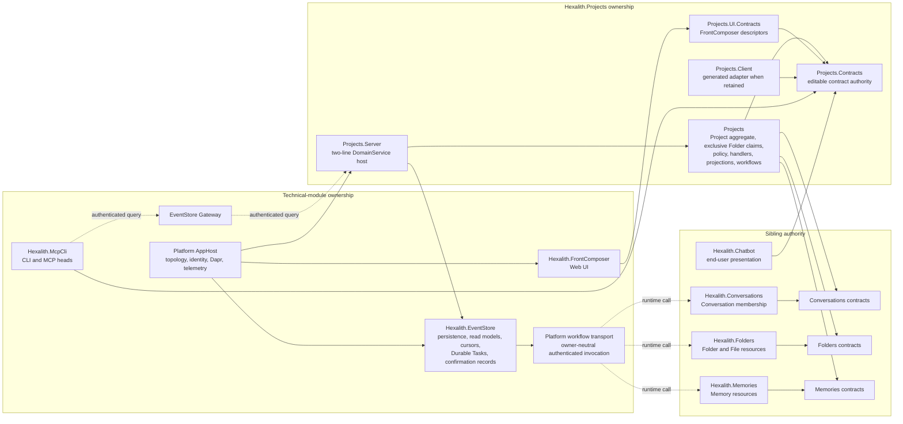
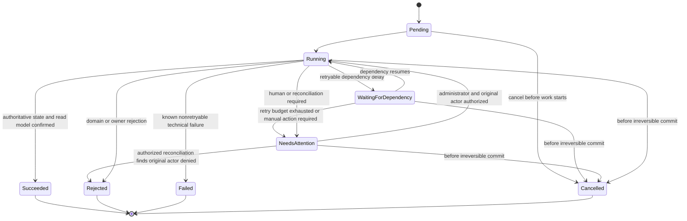
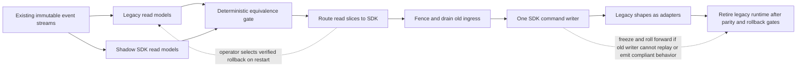
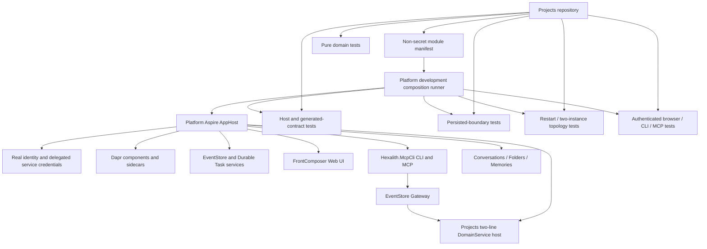

# Architecture Spine — Hexalith.Projects

## Implementation boundaries on November 20, 2026

| Boundary | What implementers can rely on |
| --- | --- |
| Read features | Stories 6.1–6.6 and 6.8 are done. Story 6.7 is in review. Its retained Debug/source packet records 77 passing authenticated comparisons and an explicit seven-read rollback for a source-hashed working tree based on `85ff9795`. Production selection, external Chatbot adoption and package qualification each need their own evidence. [Cutover and receipts](../../../../docs/read-cutover.md) |
| Writers | Story 7.1 is blocked. Whole-host SDK migration (DW-63), one authorized Folder before activation, the AD-35 exclusive claim, durable owner receipts and single-writer fencing gate the first writer. [Cutover decisions](../../sprint-change-proposal-2026-11-16-story-6-7-cutover-decisions.md) |
| Release | The broader E-17 assessment is `NOT_READY`. Story 8.11 is blocked. The November audit assigned its nine findings to existing stories. On Projects `d6583c7f`, build-and-test passed, the G-6 preflight failed and the scheduled managed journey was skipped. [Sprint tracker](../../../implementation-artifacts/sprint-status.yaml) · [Audit handoff](../../sprint-change-proposal-2026-11-20.md) · [Exact-revision CI](https://github.com/Hexalith/Hexalith.Projects/actions/runs/44758917793) |

## Design Paradigm

The target is a domain-centric, CQRS/event-sourced Projects vertical slice hosted by `Hexalith.EventStore.DomainService`. Each Project aggregate owns that Project’s lifecycle and bindings. Across Project streams, Projects serializes the exclusive claim for each Tenant and Folder (AD-35). Incremental read models own query shape. Platform Durable Tasks orchestrate cross-context work as forward-recovery sagas. Runtime, topology, identity, persistence, telemetry, and presentation adapters remain outside the domain module. The diagram assigns target ownership. DW-63 gates host migration, and G-1 gates durable task and confirmation capabilities.



Solid arrows identify composition or package dependencies. Dashed arrows identify authenticated runtime calls. Generic EventStore code depends only on owner-neutral workflow transport, never on a sibling domain contract.

## Invariants & Rules

### AD-1 — [ADOPTED] DomainService is the runtime boundary

- **Binds:** all Projects capabilities; ARCH-001; OPS-001
- **Prevents:** a second Projects-owned implementation of hosting, Dapr persistence/publication, subscription, projection, cursor, health, telemetry, or topology semantics.
- **Rule:** Projects supplies contracts, pure domain behavior, handlers, projections, and workflow definitions to `Hexalith.EventStore.DomainService`; technical runtime behavior is consumed from platform modules and is not reimplemented in this repository.

### AD-2 — [ADOPTED] Authority is assigned by bounded context and adapter role

- **Binds:** FR-1 through FR-25; ARCH-002; CLIENT-001; MCP-001
- **Prevents:** duplicated domain authority and authority expansion through a UI, CLI, MCP, Chatbot, or service caller.
- **Rule:** Projects owns Project policy and stable Project contracts; EventStore/platform owns generic runtime and durable workflow; `Projects.UI.Contracts` owns Web descriptors. FrontComposer hosts the Web surface. McpCli discovers eligible operations from decorated domain Contracts and calls the EventStore Gateway with authenticated authority. Chatbot owns candidate/proposal presentation. Conversations, Folders, and Memories retain authority over their resources.

### AD-3 — [ADOPTED] An Active or context-usable Project always has one authorized Folder

- **Binds:** FR-1, FR-2, FR-5, FR-8, FR-12, FR-16, FR-20, FR-23; NFR-4
- **Prevents:** a folderless Project appearing Active or usable as context while preserving recovery access to archived history.
- **Rule:** Project lifecycle is exactly `Active` or `Archived`; no Project appears Active, becomes a candidate, or is usable as context until exactly one authorized Folder is bound and the required read model confirms completion. Pre-activation progress exists only as Durable Task state. An authorized Archived legacy record lacking valid Folder evidence may appear only in safe recovery/list/operator views as `Unavailable`, without references or context, so FR-23 can repair it. Permitted Projects are Folder-derived. Projects issues no Project-level grant and its workload identity holds no Folder authorization. A Folder is the Project Folder of at most one Active Project. Projects enforces this across Project streams through AD-35. Legacy Active folderless Projects are quarantined until a Tenant Project Administrator binds a Folder through FR-8 (Story 7.6); they are not auto-bound and are not FR-22 reconciliation.

### AD-4 — [ADOPTED] Durable Task state is the truth for consequential work

- **Binds:** FR-1, FR-3, FR-4, FR-6 through FR-15, FR-21 through FR-23; NFR-3, NFR-4, NFR-8
- **Prevents:** acknowledgement, notification, worker memory, or mutable terminal outcomes from being treated as durable completion.
- **Rule:** Platform task records durably hold checkpoints, fenced worker ownership, leases, receipts, retries, the recorded irreversible checkpoint, compensation/reconciliation state, and terminal outcome. One durable transition authority rejects every transition absent from the state graph; restart, lease expiry, two-instance execution, and duplicate delivery converge from the last checkpoint. Active tasks remain pollable until terminal. `Succeeded`, `Rejected`, `Failed`, and `Cancelled` are immutable; `Rejected` is a known domain/owner denial, `Failed` is a known non-retryable technical failure, and an unknown partial outcome becomes recoverable `NeedsAttention`. Cancellation is allowed only before the irreversible checkpoint; afterward it returns conflict plus safe current status. HTTP `202` and SignalR never prove completion. Only a Tenant Project Administrator authorized for the task may request reconciliation. A denied administrator request leaves the task untouched. From `NeedsAttention`, check the original actor's current authority against the original Tenant, intent, targets and Preview at commit. A confirmed denial takes the existing task directly to terminal `Rejected`, writes one durable audit outcome and performs no new owner mutation. If authorized, resume from the recorded checkpoint in `Running` with the same bindings. An unavailable authority check cannot establish denial or authorize an effect. Reconciliation admits no new intent, task or Confirmation Artifact.



### AD-5 — [ADOPTED] Confirmation-required admission uses bound artifacts and scoped idempotency

- **Binds:** FR-4, FR-6 through FR-11, FR-14, FR-15, FR-23, FR-25; NFR-1, NFR-4, NFR-8
- **Prevents:** Boolean confirmation, replay, target substitution, changed-request reuse, duplicate work after a lost response, and unnecessary confirmation of actor-selected additive work.
- **Rule:** The canonical action classification identifies confirmation-required actions: archive, restore, Conversation move, Folder replacement, unlink, ambiguous-resolution confirmation, and proposed-creation confirmation. They require a server-issued 15-minute Confirmation Artifact bound to Tenant, actor, interactive session, surface, authorization-evidence version, action, targets, normalized request hash, Preview, and current versions. Additive Conversation/File/Memory links and initial Folder setting that carry valid Selection Evidence (FR-25) are task-only. Selection Evidence is minted only by the actor’s pick inside the Projects-owned component in a confidential Chatbot Project User session, or a confidential Web session registered for that role. The proof is bound to Tenant, actor, interactive session, action, subject, target and versions. It is single-use and expires in five minutes. No mint API or open/list/resolution/proposal response delivers a pick on the actor’s behalf. A new binding without valid Selection Evidence is an Inferred Association. Unless the actor confirms it through the Preview flow, return `RequestPreview`. This applies to missing, expired, consumed, wrong-surface or otherwise mismatched selection. AD-13 governs retries of work already admitted. Every advisory candidate, including `SingleCandidate` with `ConversationLinked`, is an inferred association. Only independently verified current native membership permits resumption without a new binding. Setup update and no-Folder creation remain task-only. Idempotency scope is `(Tenant, actor, operation, key)`; equivalent reuse returns the original task, changed-request reuse returns the nondisclosing conflict in AD-19, and the terminal task result plus idempotency record remain together for at least 30 days or the longer result lifetime.

### AD-6 — [ADOPTED] Migration preserves history and repository authority

- **Binds:** NFR-10, NFR-11; ARCH-001, ARCH-002, ID-001, API-001
- **Prevents:** event-history rewrite, unsafe dual command writes, implicit sibling mutation, and unversioned external dependencies.
- **Rule:** Existing committed events remain readable and unchanged. Projects planning never authorizes a sibling mutation. Every EventStore, FrontComposer, Conversations, Folders, Memories, Chatbot, identity, or Builds change requires separate repository-local scope approval, a named owner, a pinned revision/version, entry criteria, verification evidence, and rollback. Only root-declared repository/submodule checkouts are admissible evidence; nested submodules are not initialized. Historical implementation is evidence, not release authorization.

### AD-7 — [ADOPTED] Diagnostics are current, bounded, and authority-neutral

- **Binds:** FR-12 through FR-18, FR-22, FR-24; NFR-1, NFR-6, NFR-8
- **Prevents:** persisted inference history, unbounded troubleshooting payloads, and semantic drift between surfaces.
- **Rule:** Resolution Traces are request-scoped, current-only, and nonpersistent. Safe Diagnostic Export is separately authorized and bounded under AD-21. Every surface preserves server authorization and disclosure semantics. AD-29 governs which operations the public CLI and MCP may expose.

### AD-8 — [ADOPTED] Creation is Folder-first

- **Binds:** FR-1, FR-15; NFR-4
- **Prevents:** an incomplete Project stream or observable interval in which an Active Project has no Folder.
- **Rule:** A Durable Task reserves the ProjectId and creates or validates the authorized Folder through a Folders provisioning contract keyed to the hidden ProjectId; pre-activation resources are visible only to the task actor and authorized reconciliation principals, never in general Project/Folder listings or context. After acquiring the Projects claim under AD-35, it submits one Project creation commit containing the Folder binding and referencing the claim receipt. Public visibility waits for the read model. On Project User creation, Folders creates the new Folder with the original actor as sole manager and no Tenant-default read. A name collision cannot select an existing Folder. A supplied Folder requires same-Tenant manage authority, exclusive binding and the AD-5 selection or confirmation proof. Folder-created/Project-uncommitted work enters `NeedsAttention` and is resumed by reconciliation; Projects never automatically deletes the Folders-owned resource.

### AD-9 — [ADOPTED] Durable execution is platform-owned and workflow meaning is Projects-owned

- **Binds:** all consequential FRs; REL-001; TEST-001
- **Prevents:** per-domain task engines and operational task state inside Project event history.
- **Rule:** EventStore/platform owns generic task IDs, admission, records, leases, checkpoints, receipts, retry scheduling, polling, cancellation enforcement, recovery, retention, and transition integrity. Projects owns versioned workflow definitions, domain transition guards, dependency steps, completion predicates, and Recovery Action Codes.

### AD-10 — [ADOPTED] Conversations owns Conversation-to-Project membership

- **Binds:** FR-6, FR-7, FR-11, FR-12, FR-14, FR-16, FR-17, FR-20; NFR-1, NFR-4
- **Prevents:** two writable membership representations and ambiguous Conversation ownership.
- **Rule:** `Hexalith.Conversations` is the sole system of record for membership. Projects owns intent, actor/Project policy, orchestration, metadata-only audit, and a rebuildable Tenant-scoped reverse index; the Project aggregate stores no Conversation membership. Context, Conversation-start Setup and context explanation require the Conversations owner to verify the named Conversation, same Tenant and current matching `ProjectId` under original actor and delegated authority. Opening a Project is an inspection action. It supplies no membership proof. Success requires authoritative Conversations state and Projects read-model convergence. After unlink, Conversations retains a prior-membership record for the Conversation lifetime. The record is an opaque receipt: it discloses the prior Project only to an actor permitted for that Project and otherwise appears as `PriorMembershipRecorded`. Any later link is an FR-7 move. Projects’ reverse index is rebuildable and Tenant-scoped and must be able to reconstruct that receipt.

For an FR-7 move by a Project User, require manage on the target Project Folder and current Conversation read. While membership is bound, also require read on the prior Project. After a confirmed unlink, bind the prior-membership receipt in the Preview and check only the target and Conversation permissions. An Administrator moves under Tenant-role authority recognized by Conversations. Each move requires confirmation and yields one owner receipt. [PRD FR-7](../../prds/prd-Hexalith.Projects-2026-05-24/prd.md)

### AD-11 — [ADOPTED] Projects owns references, not foreign resources or authority

- **Binds:** FR-8 through FR-13, FR-16 through FR-18; NFR-1, NFR-5
- **Prevents:** copied Folder/File/Memory payloads, duplicated resource lifecycle, and cached authorization granting writes.
- **Rule:** The Project aggregate owns one Folder binding and File/Memory stable-reference membership. Folders and Memories own existence, payload, lifecycle, and authorization. Context contains only current authorized metadata; stale, rebuilding, unavailable, or excluded evidence is represented explicitly and foreign payloads are never copied. The same-Tenant predicate is evaluated before authorization for every reference, the acting session, resolution input, context component, audit row, and export row. Authorization on both ends never substitutes for it.

### AD-12 — [ADOPTED] Cross-context mutation uses an orchestrated forward-recovery saga

- **Binds:** FR-1, FR-6 through FR-11, FR-14, FR-15, FR-23; NFR-3, NFR-4
- **Prevents:** distributed-transaction assumptions, blind retries after lost responses, and destructive rollback of foreign resources.
- **Rule:** Each owner call carries a deterministic task/step idempotency key and expected owner version. The task persists the owner's durable receipt before advancing and queries authoritative status before retrying an unknown response. Compensation uses only an explicit idempotent owner command; irreducible partial work becomes `NeedsAttention`. `Succeeded` requires authoritative end state and relevant read-model confirmation. `task.reconcile` uses the same bound as AD-4: original bindings only, the AD-4 original-actor authorization check at commit, and one audited outcome on the existing task. A rejection cannot trigger another owner call.

### AD-13 — [ADOPTED] Confirmation Artifacts are opaque durable platform records

- **Binds:** FR-4, FR-7, FR-8, FR-11, FR-14, FR-15, FR-23, FR-25; AGENT-001
- **Prevents:** token disclosure, stateless replay, actor/target substitution, and confirmation/task admission races.
- **Rule:** The caller receives a high-entropy opaque token. Platform storage retains only its protected hash with Tenant, actor/delegation, action, targets, normalized request hash, Preview digest, owner versions, interactive session identifier, surface, authorization-evidence version, schema version, issue/expiry time, consumption state, idempotency scope, and admitted task ID. Issuance and consumption fail closed on a delegated-service or non-interactive claim. Consumption occurs only inside the Projects-owned confirmation component (no confirm API). Selection Evidence is the same opaque platform record class with a 5-minute lifetime and pick-time bindings (FR-25). Validation, single-use consumption, and task admission are atomic. On any replica, reauthorize an equivalent scoped retry and recover the original admitted task before revalidating spent evidence or recomputing proposal eligibility. For a new admission, reject unusable evidence before creating a task. Invalid Selection Evidence on a binding returns `RequestPreview`. Stale or expired confirmation returns `409` with `RenewPreview`. An unmatched replay or tampered Confirmation Artifact cannot admit work.

For a Folder replacement, bind the Confirmation Artifact to the versioned reader-set evidence for **both** the current and target Folders supplied by Folders. Recheck both at admission. A change to either digest invalidates the Preview even if the Folder identities and the coverage class still match. When FR-8 permits an Administrator to repair a missing or invalid prior Folder, bind the authoritative evidence of that condition and the target evidence, and recheck both. AD-33 defines what the actor can see.

### AD-14 — [ADOPTED] Query trust is incremental and rebuildable

- **Binds:** FR-2, FR-5, FR-12, FR-13, FR-16 through FR-20, FR-22; NFR-3, NFR-5, NFR-7
- **Prevents:** per-reference live fan-out, copied foreign authority, and silent use of stale evidence.
- **Rule:** Named incremental projections implement `IAsyncDomainProjectionHandler` over `IReadModelStore`/`IReadModelBatchStore` with explicit `ReadModelWritePolicy`; `IDomainProjectionHandler` is reserved for identified full-replay compatibility only. Queries implement `IDomainQueryHandler`; cursors use `IQueryCursorCodec` and authenticated `QueryCursorScope`. EventStore storage owns bounded list, detail, reference, audit, task, and reverse-membership views. A rebuildable Tenant-scoped Reference Trust Index stores safe owner metadata, owner version/watermark, authorization outcome, and freshness only. Normal context includes `Current` evidence; explicit refresh uses owner batch APIs with bounded concurrency; mutations always reauthorize with the owner. Persisted end-state, duplicate dispatch, rebuild, cursor-scope, and cursor-tamper evidence are mandatory.

Advisory resolution (FR-12/13) may use bounded observed metadata with request-time owner authorization. Return evaluation time, incomplete coverage, and unselected, disclosable IDs, scores and reasons. Omit names. Evaluation time records when the query ran and cannot serve as a source watermark. Missing File identity mapping stays incomplete. The suggestion path can operate without an installed Reference Trust Index or a global-current watermark. For FR-13 a denied, foreign-Tenant or absent attachment contributes the same result as an authorized input with no match. Other authorized inputs can still yield disclosable candidates. A denied single Conversation query retains its safe denial. Only completed coverage can yield an exhaustive `NoMatch`. Before offering acceptance, Chatbot rechecks current Folder manage. A read-only actor receives `ReadOnlyCandidate`, with no accept action or SM-7 success. Advisory results supply neither selection nor context-usability proof.

### AD-15 — [ADOPTED] One Project stream owns atomic Project invariants

- **Binds:** FR-1, FR-3, FR-4, FR-8 through FR-11, FR-19, FR-23; NFR-4, NFR-5
- **Prevents:** divergent cap, uniqueness, lifecycle, setup, or reference membership across partitioned writers.
- **Rule:** One Project aggregate stream owns lifecycle, setup, exactly one Folder binding, and the combined unique File/Memory reference identity set capped at 5,000 excluding the Folder. Commands serialize per Project. AD-35 governs contention between Projects for the same Folder. All query shape is projected. Partitioning requires measured contention or replay-budget failure and a coordinated migration.

### AD-16 — [ADOPTED] Versioned .NET contracts are the sole editable contract authority

- **Binds:** FR-1 through FR-25; NFR-10; ARCH-002; API-001; MCP-001
- **Prevents:** editable C#, OpenAPI, JSON Schema, client, MCP, CLI, and runtime vocabularies from drifting.
- **Rule:** Dependency-light `Hexalith.Projects.Contracts` owns commands, events, identifiers, DTOs, enums, action-admission classification, compatibility metadata, and all operation schemas, security semantics, and domain/wire vocabulary. It must not depend on FrontComposer Shell, Fluxor, Fluent UI, `Microsoft.AspNetCore.App`, Dapr, or Aspire. Contracts declares the typed query/result pairs. EventStore tooling generates Gateway bindings. McpCli derives machine-surface discovery from enrolled decorated Contracts. The owning generators verify schemas and clients against their hosts. Legacy shapes use explicit adapters. `Projects.UI.Contracts` depends inward on Contracts and contains presentation metadata only; it cannot redefine operations, vocabulary, or security. `Hexalith.Builds` is the sole version owner for NSwag and Fluxor.

### AD-17 — [ADOPTED] Cutover is shadow-read first and single-writer always

- **Binds:** Epic-6, Epic-7; NFR-4, NFR-10, NFR-11; ARCH-001, PERF-001
- **Prevents:** flag-day replacement, undetected projection drift, and concurrent old/new command writers.
- **Rule:** Before cutover, inventory existing events, state keys, read models, cursors, routes, clients, identities, in-flight work, consumers, Active folderless Projects, pending-Folder work, and other partial records. The SDK writer gate requires one convention-discovered `projects` aggregate deriving from `EventStoreAggregate<TState>`, `DomainResult` command behavior equivalent to current success/rejection/no-op semantics, instance `Apply` replay for every historical success/rejection event including `ProjectFolderCreationPending`, command-discriminator compatibility or explicit adapters, and deterministic golden-history plus command equivalence against the current fold. Retire the Projects-owned `IDomainProcessor` at writer cutover. For reads, replay the existing streams into shadow SDK read models and compare output, keys, watermarks, cursors and Tenant isolation. The seven primary Web reads switch together, independently of writer migration. Fence and drain old command ingress before atomically selecting one SDK writer. Legacy HTTP/client shapes adapt to that writer. Command rollback is permitted only while the old writer can both replay every new event and emit spine-compliant events and observable behavior; otherwise freeze mutation and roll forward. The read cutover preserves quarantine and leaves domain records intact. Before switching an affected writer slice, inventory its partial records and require idempotent repair tasks with durable receipts, status recovery and a terminal disposition. Folders retains ownership of provisioned resources.



**Read cutover.** The seven reads are list, open, context, Conversation-start Setup, context explanation, Conversation suggestions and attachment suggestions. Primary Web uses one immutable startup selection. The default is `Unavailable`. `Supported` requires verified comparison evidence. `LegacyRollback` requires explicit operator selection and security-verified rollback evidence. Restart or redeploy to change modes. A failed supported call cannot switch an individual request to legacy. Preserve retained v1 REST and client signatures, one-string constructors and deconstruction. Add Conversation metadata through compatible overloads. Record adoption per consumer. [Route contract and executed receipts](../../../../docs/read-cutover.md)

Compare all 77 authenticated cells under `story67-read-normalization-2026-11-16-v3`. Compare legacy Sequence and supported global position with the original GlobalPosition, and supported ProjectVersion independently with the original SequenceNumber. Keep raw statuses, keys, order and source evidence. Verify cursor scope and continuation, isolation, durable inspection audit and unchanged domain state. Only the approved cause-specific 503/200 pairs are admissible (AD-19). [Approved comparison amendments](../../story-6-7-approved-read-cutover-amendments-2026-11-16.md)

DW-63 gates Story 7.1. Prove SDK registration, authorization, dispatch and compatible reads across `/process`, `/project` and `/query` before writer cutover. For as long as the retained journal serves rollback reads, Story 8.10 requires an operator to rebuild a quarantined Tenant into a fresh generation, verify list/detail/audit against authoritative replay through a watermark, catch up concurrent delivery and switch readers atomically. An interruption must preserve quarantine, the prior generation and service to healthy Tenants. [Audit handoff](../../sprint-change-proposal-2026-11-20.md)

**Measured P1R application (approved 2026-10-06):** Attempt 21 demonstrates
retained-floor-5 hydration after restore but a 3.70.1 append drops the floor.
Therefore that package is not a qualified writable rollback target for newer
retained streams. Preserve the historical rollback coordinate; fence incompatible
writers, and apply this decision's mutation freeze plus forward recovery until a
capable replacement rollback family passes replay and compliant writes. Restoring
a pre-upgrade backup does not authorize loss of later committed events. Read-route
rollback retains its separate equivalence gate. The approved remediation requires
complete supported authority/watermark/API transport and actual published-package
proof; absent fields remain unknown and unsupported operations fail closed.

### AD-18 — [ADOPTED] Platform-generated ULIDs identify governed work

- **Binds:** FR-1 through FR-25; ID-001
- **Prevents:** GUID-shaped identifiers, caller-selected aggregate identity, and cross-surface identity drift.
- **Rule:** The platform generates ULIDs for Project, task, message, correlation, causation, event, and receipt identities. ProjectId is reserved at task admission, stable across equivalent retries, and hidden until activation. Tenant and actor come from authenticated server context; aggregate identity is `Tenant/projects/ProjectId`. Owner-defined foreign identifiers remain opaque and are never GUID-parsed. Persisted legacy IDs remain readable. Safe-channel identifiers are opaque and non-derivable from path-shaped or slug-bearing upstream identities. Projects owns a rebuildable Tenant-scoped surrogate mapping. Safe Diagnostic Export actor identifiers are pseudonymous and Tenant-salted. Reason codes are enumerated and never embed names.

### AD-19 — [ADOPTED] One observable transport mapping binds every surface

- **Binds:** FR-1 through FR-25; API-001; MCP-001; CLI-001
- **Prevents:** acknowledgement-as-success, unsafe disclosure, and surface-specific meanings for task or recovery state.
- **Rule:** After Gateway authentication, an authorized supported context computation returns `200` with `Complete`, `Partial` or `Unavailable`. Single-target access denial and absence share a safe `404` with no protected detail. AD-14 governs ignored attachments within an authorized multi-input advisory request. New admission and an exactly equivalent retry bound to the retained original task return `202` with that task location; task polls return `200` for every status. Invalid input returns `400`. Changed intent under the same scoped key returns a safe `409`. Its body and headers disclose no original task ID, Location, status or correlating detail. Stale or expired confirmation returns `409/RenewPreview`. An unmatched consumed-artifact replay or post-irreversible cancellation also returns `409`. For unusable Selection Evidence on a new binding, use `RequestPreview` under AD-5/13. Admission overload returns `429`. Failure to persist admission returns `503` and creates no task. SignalR only sends a versioned re-query notification. `Rejected`, `Failed`, `NeedsAttention`, and `Cancelled` follow AD-4 semantics.

Under v3, legacy `503` without usable context can pair with supported `200/Unavailable` for proven stale Tenant evidence, absent/unbound/unavailable native membership or the narrowly defined pending Folder. Advisory reads can pair legacy `503` with the approved explicit incomplete result for stale Tenant evidence, unsupported File coverage or degraded dependencies. Verify each cause and its disclosure fields independently. For a pending Folder require both historical `ProjectFolderCreationPending` and a current pending/folderless projection, current actor/Tenant and native membership, null Setup, no included references, `PollTask`, continued quarantine and unchanged persisted state. Other failures retain their own semantics. [Approved wire pairs](../../story-6-7-approved-read-cutover-amendments-2026-11-16.md)

### AD-20 — [ADOPTED] Cross-service authorization carries actor and workload identities

- **Binds:** all FRs; NFR-1, NFR-2; SEC-001; CLIENT-001
- **Prevents:** service-only authority, raw-token forwarding, confused-deputy behavior, and production allow-all composition.
- **Rule:** An immutable context carries server-derived Tenant, original actor, authenticated caller/workload service, delegation identifier/scopes/audience, and correlation/task IDs. Platform admission validates both credentials and fails startup on incomplete authority, audience, signing, or key configuration. Projects evaluates actor/action/Project policy; each owner reauthorizes its resource; queries filter again. Allow-all implementations exist only in explicit test composition. The immutable context includes the interactive-session claim (A-7), Folders read/manage evidence with freshness no older than the interactive dependency timeout, and the per-Tenant descriptive-metadata inspection permission when present. Only a registered confidential Chatbot or Web adapter may host the human confirmation component. It uses its own session-bound credential unavailable to the host adapter. The shipped worker subscription callbacks must enforce platform delivery policy. Shipped Server routes must validate EventStore workload and Dapr evidence. Verify allow and deny outcomes at both Release binaries, including effective deployment ingress and persisted end state. A Service/Workflow Caller is any caller without that session and never receives Confirmation Artifacts or Selection Evidence.

### AD-21 — [ADOPTED] Safe Diagnostic Export is synchronous and non-retained

- **Binds:** FR-21, FR-22, FR-24; NFR-1, NFR-6, NFR-7, NFR-8
- **Prevents:** retained diagnostic payloads, unrecoverable asynchronous results, cursored extraction, and unbounded export load.
- **Rule:** `projects.safe-diagnostic-export.v1` is a separately authorized synchronous read-only query exposed with equivalent semantics through Web, CLI, and MCP, never Chatbot. FR-22 read permission does not imply export permission. It uses one diagnostic snapshot and a platform-owned two-lease per-Tenant gate. A named stable reference sort and newest-first audit sort with stable tie-breaking produce one complete encoded response, including envelope and truncation metadata, no larger than 1 MiB, 500 reference rows, and 100 audit rows. The response reports included/omitted counts and safe truncation reason codes without excluded detail; unavailable components use safe markers. A retry creates a fresh snapshot and a separately audited attempt. Export retains no bytes and creates no cursor or task. AD-29 states the current machine-surface inventory. The export schema uses surrogates and Tenant-salted actor identifiers and enumerated reasons only.

### AD-22 — [ADOPTED] Project creation events evolve additively

- **Binds:** FR-1, FR-23; NFR-4, NFR-10
- **Prevents:** history rewrite, `V2` event forks, and new folderless creation intervals.
- **Rule:** `ProjectCreated` gains a serialization-tolerant optional Folder binding that is mandatory on every new write and nullable only during historical replay. New writes stop emitting `ProjectFolderCreationPending`; its deserializer and apply behavior remain supported. Historical Active folderless, pending-Folder, and other partial state is excluded from Active reads and enters the compensating Durable Task process in AD-17. `ProjectFolderSet` remains for legacy repair and confirmed replacement.

### AD-23 — [ADOPTED] Restore establishes Folder validity before activation

- **Binds:** FR-23; NFR-4
- **Prevents:** an Archived Project becoming Active with missing or unauthorized Folder evidence.
- **Rule:** Restore validates or establishes an authorized Folder and acquires the AD-35 claim while the Project remains Archived. A replacement emits `ProjectFolderSet` before `ProjectRestored` in one EventStore command commit. Task success waits for the Active read model; created-Folder/failed-activation work follows AD-8 recovery. A Project User may rebind a managed prior Folder or replace it under FR-8 with manage on both Folders and verified coverage of every prior reader. A Tenant Operator can only rebind the prior Folder. Only a Tenant Project Administrator may replace or create a Folder when the prior Folder is missing or unreadable, subject to the FR-8 reader-set and designated-manager rules.

### AD-24 — [ADOPTED] The target Projects package graph is domain-only

- **Binds:** Epic-6 through Epic-8; ARCH-001, ARCH-002, BUILD-001, TEST-001
- **Prevents:** domain-owned technical layers while preserving repository-local build, run, debug, and test capability.
- **Rule:** Retain packable `Projects.Contracts`, `Projects`, and `Projects.Testing`; `Projects.Testing` contains only Projects-specific builders, replay conformance, leakage, and Tenant-isolation helpers, while reusable fixtures live in `EventStore.Testing(.Integration)`. Retain non-packable `Projects.UI.Contracts`; retain non-packable `Projects.Server` only as the assembly-explicit two-line DomainService host; retain `Projects.Client` only as a generated adapter while supported consumers require it. Move/retire `Projects.Client.Generation` and `.Shared` only after the platform generator reproduces client output and compatibility fingerprints. Retire Projects-owned Infrastructure, Workers, ServiceDefaults, Aspire, AppHost, UI, MCP, and CLI runtime projects only after platform replacements and equivalent local lanes pass. `tools/release-packages.json` records the current five shipping packages, including transitional `Projects.ServiceDefaults`. Retirement requires the evidence above.

### AD-25 — [ADOPTED] Local execution uses a platform development composition runner

- **Binds:** Epic-6 through Epic-8; NFR-11; TEST-001
- **Prevents:** loss of local operability after technical-layer extraction and reintroduction of a Projects-owned AppHost.
- **Rule:** A checked-in non-secret, versioned module manifest declares the Projects host, deterministic domain/app/resource IDs and sibling dependencies. Paths are repository-relative. The target runner must also select the Projects UI descriptor assembly and verification fixture profile. Platform and Builds own the supported representation for these two inputs under G-4. The target uses an independently consumable, pinned Builds runner to validate the manifest and manage EventStore, Dapr, identity/secret injection, FrontComposer, ports, health, telemetry, and Aspire lifecycle without edits to its repository. This repository owns stable run and teardown commands, local domain/host/descriptor debugging, and manifest-aware fixtures that are thin runner consumers and contain no Projects-owned topology, Dapr, port, credential, or lifecycle definition. Pure-domain, host-contract, persisted-boundary, restart, two-instance, and authenticated browser/CLI/MCP lanes plus clean-checkout and CI package-mode parity must pass before old runtime projects are removed; Debug-only source references are insufficient.

**AD-25 applicability.** G-4 publication, common-runner rollout and clean-checkout/package parity gate retirement of old runtime projects. The approved Epic 6 exceptions use the authenticated Debug/source lane for their named stories. Keep the retained read path through Epic 8 acceptance and AD-25 retirement proof. [Read cutover](../../../../docs/read-cutover.md)

### AD-26 — [ADOPTED] Durable audit and product analytics are separate channels

- **Binds:** FR-21, FR-22, FR-24; NFR-1, NFR-8; SM-7, SM-8, SM-C4
- **Prevents:** analytics availability or 30-day retention from controlling domain/audit truth.
- **Rule:** Retain durable audit metadata for the longer of 365 days and the applicable event-history retention obligation. The audit includes task admission and terminal outcome; confirmation use/cancellation and stale/replay/tamper rejection; authorization denial; confirmed Project mutations/outcomes; manual reconciliation; export attempt/outcome; and stable upstream receipt IDs. For Folder re-anchoring, record the Project User’s permitted-set delta as counts. For a Tenant Project Administrator, audit each Preview and completion with only `NoLoss` or `Loss`, excluding counts and reader identities. Stable audit identities deduplicate equivalent idempotent retries. Intermediate task states, polls, retries, dependency latency, notifications, unused expiry, and read-only Resolution Traces are operational telemetry only. Separate versioned Projects/Chatbot outcome signals flow through a platform analytics bus to rolling 30-day aggregates and contain only state/reason/action codes, timestamps, ephemeral correlation, and correction category. Analytics is not domain history and never authorizes behavior. Descriptive-metadata inspection events are durable audit; traces and audit carry surrogates only.

### AD-27 — [ADOPTED] Platform admission owns back-pressure and dependency policy

- **Binds:** NFR-3 through NFR-8; PERF-001; OPS-001
- **Prevents:** divergent surface quotas, retries inside domain handlers, and acceptance without durable capacity.
- **Rule:** Gateway/task admission enforces per-Tenant 100 metadata reads/second with burst 200, 20 mutation admissions/second with burst 40, 1,000 nonterminal tasks, two export leases, two-second interactive dependency timeout, ten-second durable-step timeout, and at most three idempotent retries within 30 seconds before truthful waiting/intervention. Projects supports 10,000 Projects per Tenant, 5,000 references per Project, and an online/query performance shape of 100,000 audit records per Project; the audit figure is not a retention cap, and older records within the full AD-26 retention period move losslessly to a bounded, queryable platform archive. Hard Project/reference/task admission limits reject before partial durable work with safe `409` or `429` semantics; audit pressure never discards required records. Cursor pages default 50/max 200. At the authenticated warm steady-state median shape of 1,000 Projects/500 references, metadata reads have p95 under 500 ms; at supported maxima, p95 is under one second; Durable Task admission p95 is under 500 ms when required dependencies are available. Domain handlers perform no infrastructure retry or per-surface quota logic. Measure authenticated supported and rollback reads under concurrent appends on persistent Dapr/Redis at median and maximum Tenant sizes. Capture p95, bytes, allocations and conflicts before changing storage shape.

### AD-28 — [ADOPTED] The platform owns the operational and environmental envelope

- **Binds:** NFR-1 through NFR-7, NFR-11; OPS-001; BUILD-001
- **Prevents:** provider-specific infrastructure in Projects and different logical dependencies across local, CI, and production.
- **Rule:** The platform AppHost owns environment topology, Dapr component/provider binding, authenticated encryption in transit, managed encryption at rest, identity/KMS/secrets and rotation, mTLS/network policy, health/telemetry, non-root container publication, deployment, and primary-region recovery policy. Projects declares required capabilities and configuration schema only. Local, CI, and production bind the same logical resource contract. The platform configuration and evidence must enforce 99.9% monthly availability, 15-minute service RTO, accepted-task recovery or truthful `NeedsAttention` within five minutes, and committed-event RPO 0 inside the configured primary-region durability domain. Shipped Workers and Server must probe required dependencies with bounded read-only operations. A dependency outage must change readiness from 200 to 503 and back after recovery while liveness stays healthy. Tenant quarantine has its own status and isolation checks.

### AD-29 — [ADOPTED] MCP is a contained platform adapter

- **Binds:** FR-21, FR-22, FR-24; NFR-1, NFR-9; MCP-001
- **Prevents:** agent surfaces from bypassing actor authority, confirmation, admission, or release containment.
- **Rule:** `Hexalith.McpCli` composes CLI/MCP access to eligible Projects operations over versioned contracts and authenticated actor/surface authorization. Its public agent-capable heads cannot confirm end-user resolution or proposal choices, mint Selection Evidence, bypass Preview/Confirmation/Task admission, or expand permissions. The module owner opts eligible operations in through decorated Contracts in an enrolled package. McpCli discovers them in the shared catalog. The EventStore Gateway authorizes each invocation, followed by Projects and resource-owner checks. Release inventory measures coverage. A cataloged operation missing a release-inventory row produces a diagnostic and remains subject to the same runtime checks. Both public heads refuse UI-only and confirmation-required actions, including after Story 8.11 and A-7. Resolution and proposal confirmation remain on the confidential Chatbot UI.

The Story 6.6 catalog contains `projects.list`, `projects.describe`, `projects.trace-conversation` and `projects.trace-attachments`. An HTTP 200 with `Partial` or `Unavailable` keeps CLI exit 0 and the JSON disposition. Strict offline discovery at McpCli `6993abf` uses public Projects.Contracts 2.0.0. Native live qualification remains DW-82. Audit, export, task control and writes are outside that four-operation inventory. [McpCli enrollment](https://github.com/Hexalith/Hexalith.McpCli/blob/6993abfebc02c877970b20df4b17a19ed8caf102/README.md#L531)

### AD-30 — [ADOPTED] Release acceptance is machine-checkable and fail-closed

- **Binds:** NFR-9 through NFR-11; Epic-6 through Epic-8; all audit P1/P2 findings
- **Prevents:** implementation from starting on unresolved external gates and failed, skipped, or unavailable evidence from being represented as passing.
- **Rule:** The canonical evidence source is `_bmad-output/planning-artifacts/implementation-readiness-traceability-matrix.yaml`, schema `hexalith.readiness-evidence.v1`; the required Markdown matrix is a human view over the same row identities. `Hexalith.Builds` owns the `hexalith-evidence validate` capability. Each stable row key maps requirement/finding, AD, UX journey, story, repository and named owner, pinned revision/dependencies/gates, environment/fixture, exact command, evidence artifact, estimate, status, and release disposition. Validation rejects duplicate/missing keys, unresolved placeholder values, absent owner/version/command/artifact, incomplete FR/NFR/P1/P2/release categories, failed critical evidence, unexplained critical skips, and `passed` for unavailable environments. Placeholder reconciliation is atomic and grants no implementation authority; broader qualification retains the independent READY obligation. The approved Epic 6 exceptions use focused individual Debug evidence for their named read stories. Story 6.7 source parity and rollback evidence applies to the tested inputs. [Approved Story 6.7 scope](../../sprint-change-proposal-2026-11-16-unpin-story-6-7.md)

Full production release requires a passing managed authenticated journey on the exact candidate SHA, including persisted end state and recovery. A green push build with a missing, failed, skipped or wrong-SHA journey cannot qualify. The `contracts-prerequisite` and `contracts-prerequisite-verify` profiles each use their own bounded publication or verification criteria. Jerome and John record the dated Story 8.11 deployment, rollback and stakeholder disposition. Platform AD-14 continues to bar public CLI/MCP confirmation and Selection Evidence after release. [November 20 acceptance criteria](../../sprint-change-proposal-2026-11-20.md)

The approved 2026-10-02 G-6 applicability change narrows only the runtime/toolchain proof boundary. A current G-6 result still needs an approved effective tuple and passing critical runtime evidence; its absence, failure, or skip cannot be recorded as an AD-30 pass. Full release reruns the focused qualifier on its exact source. This does not change any other evidence row or terminal release condition.

### AD-31 — [ADOPTED] Canonical creation classifies metadata before admission

- **Binds:** FR-1, FR-15, FR-19; NFR-1, NFR-10; API-001
- **Prevents:** user text selecting its own sensitivity, protected parsing before authorization, inconsistent direct/proposal validation, and silent expansion of the legacy creation path.
- **Rule:** Canonical Create Project accepts exactly `public_metadata`, `tenant_sensitive`, `credential_sensitive`, or `secret` at `projectMetadata.metadataClass`, assigned by authenticated integration policy and never inferred from user text. Authorization precedes protected metadata parsing; malformed or unknown values return `400 ValidationFailure` with metadata-only `details.rejectedField = projectMetadata.metadataClass`, and no command is submitted. One `SensitiveMetadataTierValidator` governs direct creation and proposal confirmation; `secret` is a classification label, never permission to store secret content. Only the historical unversioned name-only request is a v1 compatibility shape and remains accepted/readable throughout v1; retirement requires a major version, migration notice, usage evidence, compatibility tests, and rollback evidence.

### AD-32 — [ADOPTED] One response snapshot governs context usability

- **Binds:** FR-2, FR-3, FR-5, FR-12 through FR-20; NFR-1, NFR-3, NFR-5
- **Prevents:** adapters inventing incompatible response fields, silently treating stale evidence as usable, selecting unauthorized candidates, or admitting Chatbot first response on insufficient evidence.
- **Rule:** Applicable list, open, context, Conversation-start and proposal-recovery results contain `responseState`, `asOf`, authorized `projectVersion` when disclosable, conditional `resolutionResult`, metadata-only `components`, and `recoveryActions`. Components use inclusion `Included|Excluded`, freshness `Current|Stale|Rebuilding|Unavailable`, safe reason and last-verified time. The separate advisory contract uses `NoMatch|SingleCandidate|MultipleCandidates` and reasons `ConversationLinked|ProjectFolderMatched|FileReferenceMatched|MemoryMatched|MetadataMatched`. `Complete` requires all required components current and each optional component current or explicitly `ExcludedBySetupPolicy`. If all required evidence is current but any other optional evidence is excluded, stale, rebuilding or unavailable, return `Partial` and identify every omission. Setup can make a reference required. `Unavailable` blocks use when required evidence is missing/non-current; `Denied` discloses no protected detail. Neither state selects a resolution candidate.

For FR-5 list reads, evaluate the enumeration and each authorized row separately. An authorized, current enumeration returns `Complete` even when a visible row has non-current Folder evidence. That row returns `Unavailable`. Preserve the same authorization, quarantine, ordering and cursor rules on every page.

Context, Setup and context explanation require AD-10 native membership as well as current Project, Folder and actor authority. If an actor may read the Project but membership is missing, unbound or unavailable, return `Unavailable` with null Setup and no included references. A different `ProjectId` withholds the requested context. Project/Tenant denial remains a safe `404`. Chatbot admits a first response only for `Complete` or usable `Partial` after membership verification. Advisory output follows the observed-data exception in AD-14 and cannot admit a first response. `RefreshContext` is a read-only recomputation with a new snapshot and no maintenance audit; Setup update is idempotent, durable, and complete only after authoritative read-model confirmation. Recovery codes are exactly `None|Retry|RefreshContext|RequestPreview|RenewPreview|PollTask|ResolveNeedsAttention|SelectAlternative|ContactAdministrator`.

### AD-33 — [ADOPTED] Action authorization is role-specific and surface-invariant

- **Binds:** FR-1 through FR-25; NFR-1; SEC-001; CLIENT-001; MCP-001
- **Prevents:** Web, CLI, MCP, Chatbot, or delegated callers independently expanding an actor's authority.
- **Rule:** Every adapter enforces the same action matrix after AD-20 authentication; action-specific policy and owner reauthorization may narrow it, never widen it. A session exercises either Project User authority or Tenant-role authority. Their permissions cannot be combined. A Service/Workflow Caller may perform only delegated reads, FR-3 Setup updates and FR-1 creation with no supplied Folder, within the original actor’s authority. Human confirmation and selection require a confidential interactive session.

| Action | Project User (Folder read) | Project User (Folder manage) | Tenant Operator | Tenant Project Administrator |
| --- | --- | --- | --- | --- |
| Open / list / resolve / context / explain / refresh / Conversation-start | Allowed (Chatbot; Folder-derived) | Allowed | Allowed (Web/CLI/MCP; Safe Metadata default) | Allowed (Web/CLI/MCP; Safe Metadata default) |
| Inspect Descriptive Metadata | Allowed for permitted Projects | Allowed for permitted Projects | Separately authorized, audited | Separately authorized, audited |
| Confirm ambiguous resolution | Denied | Chatbot only, with manage on the chosen Project Folder and current Conversation read | Denied | Denied |
| Confirm proposed creation | Chatbot only, no prior Project authority required. A supplied Folder requires manage. | Same FR-1 conditions | Denied | Denied |
| Select association target (`selection.mint`) | Denied | Allowed (Chatbot in v1, confidential Web if registered for Project Users) | Denied | Denied |
| Create Project (`project.create`) | Allowed (no prior Project authority; created Folder names actor sole manager) | Allowed | Denied | Denied |
| Update Setup (`project-setup.update`) | Denied | Allowed | Denied | Denied |
| Archive or restore (rebind prior Folder) | Denied | Allowed | Allowed (Web only; McpCli CLI/MCP refuse it under AD-29) | Allowed (same surfaces) |
| Restore with replacement or same-name Folder | Denied | FR-8 manage on both and full prior reader coverage | Denied | FR-8 rules. Exclusive authority if prior Folder is missing or unreadable. |
| Add Conversation/File/Memory link or initially set Folder | Denied | Allowed (Selection Evidence or confirmed inference) | Denied | Denied |
| Move Conversation (FR-7) | Denied | Target Folder manage and Conversation read. Prior Project read while bound. After confirmed unlink, use the prior-membership receipt under AD-10. | Denied | Tenant-role authority recognized by Conversations |
| Unlink reference (FR-11) | Denied | Allowed on a managed Project | Denied | Allowed under Tenant-role authority |
| Replace Folder | Denied | Manage on both, no reader loss. Preview shows the permitted-set delta as counts. | Denied | Preview shows only `NoLoss`/`Loss`. May reduce the set only when the current Folder is invalid or missing. Reject Administrators in the target reader set. Name the designated Project User as sole manager on create. |
| Bind quarantined legacy Folder | Denied | Denied | Denied | FR-8 Preview and confirmation under the same Administrator rules |
| Inspect pre-activation task status | Own permitted tasks through Chatbot | Own permitted tasks through Chatbot | Authorized tasks | Authorized tasks |
| Inspect quarantined legacy Project inventory (FR-22) | Denied | Denied | Denied | Per-Project audited inspection under the exception below |
| Reconcile `NeedsAttention` | Denied | Denied | Denied | Allowed (task-control; original bindings only) |
| Safe Diagnostic Export | Denied | Denied | Separately authorized | Separately authorized |

**Pre-activation task status.** For every role the complete allow-list is task identity, Task Status, safe reason codes, Recovery Action Codes, timestamps and expiry. Withhold the reserved Project identity, names, Folder/File/Memory identifiers, Setup and Conversation identifiers until Read-Model-Confirmed Completion. Pre-activation tasks stay outside Project list and open.

**Quarantined legacy inventory.** The separate FR-22 inventory is restricted to Tenant Project Administrators. It returns Safe Metadata plus only the Project name and any pre-v1 Folder or creation receipt. Withhold Setup and titles. Require one successful durable FR-21 inspection event per returned Project before disclosure. Until the A-5 inspection permission is available, the Administrator role gates this narrow exception. Once available, require the permission as well. Only the FR-8 binding workflow can take a Project out of quarantine.

Retained v1 list and open require real Project names. Before returning them to any caller, require explicit descriptive-inspection opt-in, the existing inspection permission and a successful durable Safe Metadata audit. Failure discloses no names. On supported reads, Tenant roles receive Safe Metadata by default. Authorized Chatbot Project Users may receive the name on their permitted Projects. Mandatory inspection audit precedes disclosure even when the same request causes no domain write. [PRD FR-2, FR-5 and FR-22](../../prds/prd-Hexalith.Projects-2026-05-24/prd.md)

McpCli (CLI and MCP heads) follows AD-29. The matrix expresses actor authority. Each head exposes only its enrolled operations, and both public heads refuse UI-only and confirmation-required actions regardless of A-7 or Story 8.11. [Approved surface decision, E5 and E9](../../sprint-change-proposal-2026-11-15-schedule-stories-6-8-and-6-6.md)

### AD-34 — [ADOPTED] Accessible completion is a release invariant

- **Binds:** FR-14, FR-15, FR-22 through FR-24; NFR-9; SM-5
- **Prevents:** functionally correct flows that cannot be completed by keyboard, assistive technology, zoom, or narrow viewport.
- **Rule:** Chatbot and operator presentation owners meet WCAG 2.2 AA with full keyboard operation, deterministic focus placement/restoration, accessible names/instructions, non-color-only state, status/live-region announcements, 200% zoom, and 320 CSS-pixel reflow without loss of action or evidence. Release evidence combines automated checks with authenticated manual keyboard and screen-reader review at small, median, and maximum data shapes; any unresolved critical or serious accessibility violation blocks the capability and release.

### AD-35 — [ADOPTED] Projects owns the exclusive Active Project Folder claim

- **Binds:** FR-1, FR-4, FR-8, FR-23 and FR-15 proposed creation through FR-1. Applies to create, replacement, restore, legacy Folder repair and archive.
- **Prevents:** different Project streams activating against the same Folder, a lost reply admitting a second winner, and a stale worker releasing a later claim.
- **Rule:** Projects serializes claim acquisition by `(TenantId, FolderId)` across all writers. Folders supplies current resource and actor-authorization evidence. Before a Project commit can establish an Active binding, the task must hold the exclusive claim for that Project and Folder. Atomic acquisition records the Project, task/step and claim generation in a durable receipt. Competing Projects fail closed without disclosure of the holder. An equivalent retry on any replica recovers the original receipt by task/step. After a lost reply, query authoritative claim status before retrying.

Commit the binding against the expected Project version with the winning receipt. Fence the commit so an obsolete generation cannot install a binding after release. On replacement, acquire the incoming claim first. Release the outgoing claim only after the authoritative Project commit records the replacement or archive and stale writers can no longer reinstall it. A conditional release names the exact Project and claim generation. Abandoned reservations may be released only after authoritative evidence proves the binding did not commit and its outstanding commit is fenced. While the outcome is unknown, retain the claim and recover under AD-4 and AD-12. Neither a worker timeout nor a read-model observation authorizes release.

At writer cutover, fence legacy writes under AD-17. Reconstruct existing Active bindings from authoritative history and reserve each occupied `(TenantId, FolderId)` for its incumbent before opening that key to any writer. Keep the key closed to every claimant while its history is incomplete or holders conflict. Verify that a new Project cannot claim a legacy incumbent’s Folder. For a free Folder, race two Projects, lose the winner’s reply and resume its task on another replica. The retained claim receipt and authoritative Project histories must show at most one Active holder. Replaying a stale release after a later acquisition must preserve the later holder.

## Consistency Conventions

| Concern | Convention |
| --- | --- |
| Project lifecycle | Exactly `Active` and `Archived`; creation progress is never a lifecycle value. |
| Task and response vocabulary | Use the exact Task Status, Context Response State, Evidence Freshness State, Resolution Result, and Recovery Action Code vocabularies from the PRD; adapters do not create synonyms. |
| Commands and events | Imperative command names, past-tense event names, no `Command`/`Event` suffix, structured rejection events, pure `Handle` and `Apply`, persist before publish. |
| Event evolution | Additive and serialization-tolerant; no `V2` event types and no committed-history rewrite. |
| Identifiers | Framework-generated ULIDs for governed identities; server-derived Tenant/actor/aggregate identity; foreign IDs remain opaque; persisted legacy IDs stay readable. |
| Serialization and canonicalization | `System.Text.Json`; canonical request hashing rejects U+2028/U+2029 in identity/envelope fields and preserves byte-identical direct-server/generated-helper escaping for accepted descriptive metadata. Tests prove no collision with LF or literal backslash-`u`, stable unaffected hashes, and generated-file protection. Before canonical bytes change, inspect deployed fingerprints and gate a bounded legacy-hash strategy when affected values exist. Request equivalence is never broadened. |
| Contracts | Editable contract types live in `Projects.Contracts`; generated artifacts are changed through their generator/source contract and verified against a live host, never hand-edited. |
| Files and types | One handwritten C# type per same-named file; generated artifacts are exempt and remain generator-owned. |
| Query ordering and cursors | Stable deterministic ordering; EventStore-scoped opaque cursors bound to authenticated query scope; default 50 and maximum 200 rows. |
| Errors and disclosure | Use AD-19 status semantics and stable metadata-only reason/recovery codes; denial and nonexistence are boundary-indistinguishable; never echo rejected sensitive values or raw upstream problems. |
| Authentication and authorization | AD-20 dual-principal context; Tenant and actor are never trusted from body/header substitutes; every owner and every query reauthorizes. |
| Logging, telemetry, and audit | Source-generated structured logs with stable event IDs; metadata-only, low-cardinality fields; never log payloads, names, prompts, paths, tokens, secrets, or raw command bodies. |
| Outcome measurement | Rolling 30-day metadata-only Projects/Chatbot aggregates use the PRD definitions of eligible resolution, eligible resumption, continuity success, and context correction. SM-7 and SM-8 require at least 90%; SM-C4 is at most 5%. Expired, abandoned, degraded, unavailable, and timed-out eligible outcomes remain in denominators as specified; reports include numerator, denominator, excluded counts by safe reason, `Partial`, `Unavailable`, and correction counts. Zero eligible resumptions is `insufficient volume`, never 100%. Deterministic authenticated fixture parity is release evidence. |
| Configuration | Central package versions, no inline package pins, production fail-fast for missing security configuration, no provider-specific settings in domain packages. |
| Build and test | `.slnx` only; Debug plus project references locally, Release plus package references in CI; each test project runs individually; integration asserts persisted end state. |

## Stack

Projects revision `d6583c7f` records Builds `2c33b2d7`. Use the committed Builds catalog to reproduce the repository's package choices. Root-level submodule worktrees at newer upstream revisions are separate source inputs. [SDK policy](../../../../global.json) · [Build configuration](../../../../Directory.Build.props) · [Committed Builds catalog](https://github.com/Hexalith/Hexalith.Builds/blob/2c33b2d749a2f7b8c67a15130a815996f83a51a5/Props/Directory.Packages.props) · [Shipping package contracts](../../../../tools/release-packages.json)

| Name | Version | Scope |
| --- | --- | --- |
| .NET SDK / target | `11.0.100` with `latestPatch` / `net11.0` | Stable SDKs only, C# selected by `LangVersion=latest` |
| EventStore / FrontComposer | `5.4.0` / `6.0.1` | Consumer packages. EventStore P1R acceptance has its own version and evidence below. |
| McpCli.Abstractions | `3.0.0` | Machine discovery metadata in Projects.Contracts |
| Aspire SDK and CLI / CommunityToolkit.Aspire.Hosting.Dapr | `17.0.0` / `17.0.0-beta.1078` | Current G-6 source policy, with an explicit Toolkit prerelease exception |
| Dapr CLI and .NET packages | `1.19.1` | The root Builds catalog selects runtime `1.19.2`. The Projects source-mode G-6 policy and CI select runtime `1.19.1`. Record the runtime actually tested. Dapr.Workflow remains unselected. |
| Fluent UI / Fluxor | `5.1.0` / `6.11.0` | Presentation dependencies belong on the UI side of the Contracts boundary. |
| ByteAether.Ulid / NSwag.MSBuild | `1.4.2` / `14.8.0` | Shared catalog |
| xUnit v3 / Shouldly / NSubstitute | `4.0.3` / `4.3.0` / `6.2.0` | Test tooling |

The November G-6 policy selects a source-mode tuple and exceptions with proof reuse disabled. The qualifier acquires the catalog selected by Platform `a74abe17` (Builds `dc225a69`). An exact-source qualifier, including real PostgreSQL two-sidecar restart, provenance and cleanup, is required for full release. CI failed at preflight for `d6583c7f`. [Projects G-6 policy](../../../../tools/qualification/g6-current-policy-2026-11-12-dapr-net1191.json) · [Catalog acquisition](../../../../.github/actions/prepare-g6-catalog/action.yml) · [Release workflow](../../../../.github/workflows/release.yml) · [G-6 result](https://github.com/Hexalith/Hexalith.Projects/actions/runs/44758917793/job/136367855788)

**Historical qualification.** The October 1 P1R decision accepted EventStore `3.110.0` at `27279fe6` with Builds `4.29.1` at `21ce044a` and the packet's limitations. The October 6 remediation records seven incompatible dispositions in attempt 21. The recorded P1R current-usability decision remains false. The `3.70.1` rollback writer can lose the retained floor. AD-17 requires a qualified writable rollback or mutation freeze and forward recovery. G-6 attempt 16 covers its October 1 beta.910 source. The October 3 preview decision and later qualifying run also apply only to their recorded inputs. Keep original acceptances, failures and scope with their packets. [P1R acceptance](../../../implementation-artifacts/6-1-p1r-acceptance.json) · [P1R remediation](../../sprint-change-proposal-2026-10-06.md) · [G-6 attempt 16](../../../implementation-artifacts/qualification-evidence/g-6-runtime-toolchain-20261001/attempt-16/packet.json) · [G-6 scope correction](../../sprint-change-proposal-2026-10-02.md)

## Structural Seed

### Target Projects-owned artifacts

| Artifact | Packaging | Contents |
| --- | --- | --- |
| `Hexalith.Projects.Contracts` | Packable | Versioned domain/wire vocabulary and compatibility metadata |
| `Hexalith.Projects` | Packable | Aggregate, domain policy, handlers, projections, workflow definitions |
| `Hexalith.Projects.UI.Contracts` | Non-packable | FrontComposer descriptors only |
| `Hexalith.Projects.Server` | Non-packable host | Assembly-explicit two-line DomainService host plus module registration |
| `Hexalith.Projects.Client` | Generated, conditional | Compatibility/consumer adapter while supported consumers require it |
| `Hexalith.Projects.Testing` | Packable | Projects-specific builders and replay/leakage/Tenant-isolation support only |
| Module manifest | Checked-in, non-secret | v2 host/app identity and sibling capabilities. G-4 owns runner selection of the descriptor assembly and fixture profile. |

The target Server discovers the domain assembly explicitly. Today the shipped Server still registers the Projects runtime. DW-63 governs the transition. [Current Server composition](../../../../src/Hexalith.Projects.Server/Program.cs)

```csharp
builder.AddEventStoreDomainService(typeof(ProjectAggregate).Assembly);
app.UseEventStoreDomainService();
```

`Projects.Client.Generation` and `.Shared` are migration inputs, not target artifacts; the platform generator must reproduce their output and compatibility fingerprints before they are retired.

### Canonical action-admission classification

`Projects.Contracts` owns this versioned classification; OpenAPI, Web, CLI, MCP, and Chatbot adapters generate from it and cannot infer confirmation policy from UI shape.

| Admission class | Stable action IDs | Contract |
| --- | --- | --- |
| Confirmation plus Durable Task | `project.archive`, `project.restore`, `conversation.move`, `project-folder.replace`, `context-reference.unlink`, `resolution.confirm`, `project-proposal.confirm` | AD-5 Preview and Confirmation Artifact (including session/surface/authorization-evidence binding), then idempotent task admission |
| Direct Durable Task | `project.create` with no supplied Folder, `project-setup.update` | Ordinary creation provisions a new Folder under AD-8. Setup updates require Folder manage. Proposed creation uses its own confirmation action. |
| Association admission | Supplied Folder on `project.create`, `conversation.link`, `project-folder.set-initial`, `file-reference.link`, `memory.link` | Valid Selection Evidence admits actor-selected work as a Durable Task. An inferred binding requires Preview and confirmation. A File link to a foreign Folder always requires confirmation. |
| Durable Task control | `task.cancel`, `task.reconcile` | No artifact, no new task, original bindings only; AD-4 transition rules apply; reconciliation is Administrator-only |
| Synchronous read | list/open/resolve/context/refresh/validate/Conversation-start/audit/operator-read and `safe-diagnostic-export.create` | No task or Confirmation Artifact; export retains separate action authorization and AD-21 bounds |
| Selection mint | `selection.mint` | Synchronous, session-bound, mints Selection Evidence; no Durable Task; no Confirmation Artifact |

### Repository-owned runner contract

The Projects owner declaration is `module/hexalith.module-manifest.v2.json`. It names the internal `projects/domain` Server, dependencies and workload-facing operations. Use the released Builds CLI for source preparation. Projects selects Module.Cli `6.4.2`. Its local .NET tool manifest pins FrontComposer CLI `6.0.1` only. [Owner declaration](../../../../module/hexalith.module-manifest.v2.json) · [Preparation contract](../../../../module/README.md) · [Tool manifest](../../../../.config/dotnet-tools.json) · [Builds CLI selection](../../../../Directory.Packages.props)

```sh
hexalith-module prepare-build --manifest module/hexalith.module-manifest.v2.json --mode source --workspace <fresh-absolute-directory> --output json
```

Use the emitted build environment for Debug source builds. Runtime startup also requires owner-supported bindings and scoped identity for each dependency. AD-25 requires authenticated and persisted parity, recovery, teardown and package-mode evidence before retiring the existing AppHost. The diagram depicts that target.

### Local and platform topology



### External capability entry gates

| Gate | Required capability | Entry condition |
| --- | --- | --- |
| G-1 | EventStore/platform Durable Tasks and opaque Confirmation Artifacts | Before the first writer, obtain the repository-approved task and receipt pins, atomic artifact consumption and admission, and restart/two-replica evidence. Read features and EventStore package adoption do not establish this capability. |
| G-2 | Projects integration with Conversations, Folders and Memories | Before the first affected writer, Projects must prove the AD-35 claim and recovery across replicas with current Folders authorization. Pin each workflow’s expected-version checks, idempotency keys, durable receipts and status queries, safe batch reads and explicit compensation. Folders must verify current read/manage permissions and reader-set coverage and delta for both Folders, including authoritative prior absence where applicable. Its create-only operation must suppress Tenant-default read and support one named sole manager or no manager. FR-1 names the creating Project User as sole manager. Administrator creation under FR-8 names the designated Project User. Folders and Conversations must recognize the applicable Tenant roles under A-3, and Conversations must return the prior-membership receipt. Missing A-3 capabilities block the affected operations. Pin each owner’s identifier shape for the AD-18 Safe-channel surrogate map. |
| G-3 | FrontComposer Web and McpCli | Web descriptor discovery and confidential credential propagation belong to FrontComposer. McpCli owns machine discovery and dispatch. The EventStore Gateway authorizes calls, and Projects and the respective resource owners enforce actor/resource policy. Current enrollment is the four AD-29 reads. Live qualification, parity, and retirement require evidence for each affected surface. |
| G-4 | Platform development composition | The v2 declaration and source preparation are available. The pinned schema rejects unknown fields. Platform/Builds must document supported bindings for the UI descriptor assembly and fixture profile and demonstrate both selections before runtime retirement. Require clean Debug and CI package-mode startup, teardown, identity, persisted recovery and authenticated Web/CLI/MCP proof before retiring the Projects-owned runtime. |
| G-5 | Platform identity, KMS, secrets, telemetry, and environment bindings | Fail-fast dual-principal admission, key rotation/revocation, encryption, health, deployment, and recovery evidence; interactive-session claim (A-7); per-Tenant descriptive-metadata inspection permission (A-5) |
| G-6 | Runtime/toolchain alignment | Record effective inputs, owner-approved exceptions and a passing isolated restart qualifier. Use the reviewed Platform catalog and the Projects policy in Stack. A full release reruns the qualifier on its own SHA. A missing, skipped or failed run blocks qualification. |

## Capability → Architecture Map

| Capability / Area | Lives in | Governed by |
| --- | --- | --- |
| FR-1 Create Project | Projects creation workflow, Project aggregate, EventStore task engine, Folders owner | AD-3, AD-5, AD-8, AD-9, AD-12, AD-13, AD-22, AD-35 |
| FR-2 and FR-5 Open/List | EventStore read models and authorization-filtered handlers | AD-3, AD-14, AD-17, AD-19, AD-20, AD-27, AD-33 |
| FR-3 and FR-19 Setup update/validation | Projects aggregate, shared validators, Contracts | AD-15, AD-16, AD-18, conventions |
| FR-4 and FR-23 Archive/Restore | Projects lifecycle workflows and aggregate | AD-3 through AD-5, AD-12, AD-13, AD-23, AD-35 |
| FR-6, FR-7, and Conversation part of FR-11 | Conversations authority, Projects workflow and reverse index | AD-4, AD-10, AD-12 through AD-14 |
| FR-8 through FR-11 Folder/File/Memory associations | Project aggregate references, Folders/Memories authorities, Projects workflows | AD-3, AD-11 through AD-15, AD-35 |
| FR-12 through FR-15 Resolution and proposal | Projects current resolution policy, Chatbot presentation, Projects workflows | AD-5, AD-7, AD-10, AD-13, AD-14, AD-19, AD-29 |
| FR-16 through FR-20 Context and Conversation start | Projects query handlers, Reference Trust Index, Project read models | AD-3, AD-7, AD-10, AD-11, AD-14, AD-19, AD-20, AD-32 |
| FR-21 Audit | Project/event and platform security-event projections | AD-21, AD-26, AD-30 |
| FR-22 Operator read | FrontComposer Web and enrolled McpCli operations over Projects contracts and read models | AD-2, AD-14, AD-19, AD-20, AD-26, AD-29, AD-33 |
| FR-24 Safe Diagnostic Export | Synchronous Projects query plus platform lease and audit | AD-7, AD-19, AD-21, AD-26, AD-27 |
| FR-25 Select Association Target | Projects-owned selection component on confidential Chatbot or registered Project User Web sessions | AD-2, AD-5, AD-13, AD-20, AD-33 |
| NFR-1 and NFR-2 Security/privacy/encryption | Platform identity/KMS/admission plus owner reauthorization | AD-11, AD-13, AD-20, AD-28 |
| NFR-3 and NFR-4 Availability/durability | EventStore runtime, Durable Tasks, Project aggregate | AD-3, AD-4, AD-9, AD-12, AD-28 |
| NFR-5 through NFR-7 Scale/bounds/back-pressure | Incremental read models, gateway/task admission, Projects contract bounds | AD-14, AD-15, AD-21, AD-27 |
| NFR-8 Retention/transience | Platform task/confirmation/audit stores and nonpersistent diagnostics | AD-4, AD-5, AD-7, AD-21, AD-26 |
| NFR-9 Accessibility | Chatbot and FrontComposer presentation owners | AD-2, AD-29, AD-30, AD-34 |
| NFR-10 Compatibility | Contracts, event evolution, adapters, staged cutover | AD-6, AD-16 through AD-18, AD-22 |
| NFR-11 Release evidence | Cross-repository machine-checkable evidence gate | AD-25, AD-28, AD-30 |
| Epic-6 Authorized reads | Contracts, SDK read models, trust index, generated read adapters | AD-14, AD-16, AD-17, AD-20, AD-25 |
| Epic-7 Durable decisions | Projects workflow definitions and platform Durable Tasks | AD-3 through AD-5, AD-8 through AD-13, AD-23 |
| Epic-8 Safe operations/release | Platform adapters, export, observability, environment and evidence gates | AD-21, AD-25 through AD-30 |

## Deferred

| Decision deferred | Revisit condition |
| --- | --- |
| Exact platform package, database/provider, lease algorithm, and scheduler for Durable Tasks and Confirmation Artifacts | G-1 platform design approval; ownership and behavioral rules in AD-4, AD-9, and AD-13 remain binding |
| Cryptographic hash, token generation, KMS product, and key-rotation mechanics | G-5 security design and threat-model review; opaque protected-hash and fail-closed rules remain binding |
| Project reference partitioning | Measured per-Project contention or replay-budget failure at the supported 5,000-reference shape |
| Exact Reference Trust Index storage schema and owner batch protocol | G-2 pinned owner contracts and Epic-6 performance test design; metadata/freshness/authority boundaries remain binding |
| `Projects.Client` retirement date and legacy HTTP/identifier/tool compatibility windows | Supported-consumer and persisted-usage evidence plus approved major-version and rollback plan |
| Expansion beyond the four enrolled McpCli reads, Chatbot interaction design, operator information architecture, and visual styling | UX/API artifacts; AD-2, AD-19, AD-20, and AD-29 constrain authority and semantics |
| Analytics bus/provider and aggregate-store implementation | Platform analytics design; AD-26 fixes channel separation, metadata boundary, and 30-day window |
| Cloud provider, region count, and cross-region disaster recovery | Deployment architecture; cross-region DR is outside v1, while AD-28 fixes the logical environment and primary-region obligations |
| Per-story fixture catalogs, test matrices, benchmark harnesses, and CI partitioning | Test design and story decomposition; AD-30 fixes evidence completeness and release behavior |
| Multiple Project Folders or multi-Project Conversation membership | A separately approved product requirement and conflict/authorization model |
