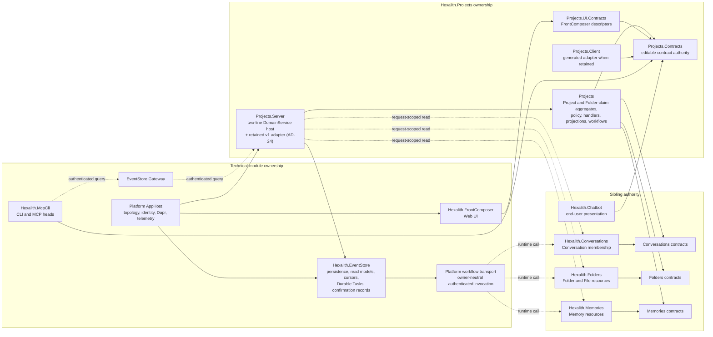
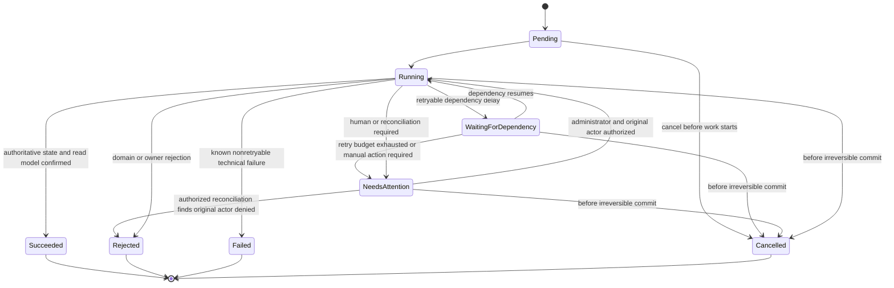
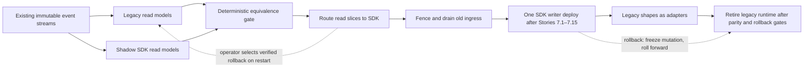
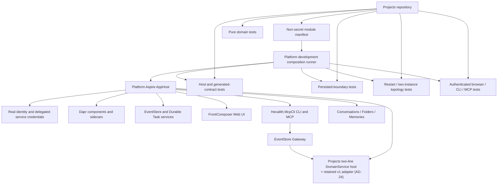

# Architecture Spine — Hexalith.Projects

## Implementation boundaries

| Boundary | Gate condition (status: [sprint tracker](../../../implementation-artifacts/sprint-status.yaml)) |
| --- | --- |
| Read features | Production `Supported` selection, external Chatbot adoption and package qualification each need their own evidence; selection needs the AD-17 v4 packet, and selection and adoption the AD-14 DW-85 condition. [Cutover and receipts](../../../../docs/read-cutover.md) |
| Writers | DW-63 hosts the existing processor as single writer and the AD-24 adapter on the SDK host; the Stack EventStore row gates its CI evidence. Accepted 7.1-P1/P2 packages, one authorized Folder before activation, the AD-35 claim, durable owner receipts and single-writer fencing gate the first writer; Story 7.16 consumes the separately accepted writer capability record. The writer cutover is the one AD-17 deploy. [DW-63 specification](../../../implementation-artifacts/spec-dw-63-migrate-projects-server-to-eventstore-sdk-host.md) · [Readiness-blocker correction](../../sprint-change-proposal-2026-11-24-readiness-blockers.md) |
| Release | Section G human sign-off on both Epic 8 cohesion decisions, and AD-30 evidence. [Section G](../../epics-architecture-conformance-checklist-2026-07-16.md#section-g--human-signoff-packet) |

## Design Paradigm

The target is a domain-centric, CQRS/event-sourced Projects vertical slice hosted by `Hexalith.EventStore.DomainService`. Each Project aggregate owns that Project’s lifecycle and bindings. Across Project streams, Projects serializes the exclusive claim for each Tenant and Folder (AD-35). Incremental read models own query shape. Platform Durable Tasks orchestrate cross-context work as forward-recovery sagas. Runtime, topology, identity, persistence, telemetry, and presentation adapters remain outside the domain module. The diagram assigns target ownership. DW-63 gates host migration, and G-1 gates durable task and confirmation capabilities.



Solid arrows identify composition or package dependencies. Dashed arrows identify authenticated runtime calls: request-scoped owner reads and reauthorization go host-direct under the delegated actor; durable cross-context mutation goes through workflow transport (AD-12). Generic EventStore code depends only on owner-neutral workflow transport, never on a sibling domain contract.

## Invariants & Rules

### AD-1 — [ADOPTED] DomainService is the runtime boundary

- **Binds:** all Projects capabilities; ARCH-001; OPS-001
- **Prevents:** a second Projects-owned implementation of hosting, Dapr persistence/publication, subscription, projection, cursor, health, telemetry, or topology semantics.
- **Rule:** Projects supplies contracts, pure domain behavior, handlers, projections, and workflow definitions to `Hexalith.EventStore.DomainService`; technical runtime behavior is consumed from platform modules and is not reimplemented in this repository.

### AD-2 — [ADOPTED] Authority is assigned by bounded context and adapter role

- **Binds:** FR-1 through FR-25; ARCH-002; CLIENT-001; MCP-001
- **Prevents:** duplicated domain authority and authority expansion through a UI, CLI, MCP, Chatbot, or service caller.
- **Rule:** Projects owns Project policy and stable Project contracts; EventStore/platform owns generic runtime and durable workflow; `Projects.UI.Contracts` owns Web descriptors, which FrontComposer hosts. McpCli discovers eligible operations from decorated Contracts and calls the EventStore Gateway with authenticated authority. Chatbot owns candidate/proposal presentation. Conversations, Folders and Memories keep authority over their resources.

### AD-3 — [ADOPTED] An Active or context-usable Project always has one authorized Folder

- **Binds:** FR-1, FR-2, FR-5, FR-8, FR-12, FR-16, FR-20, FR-23; NFR-4
- **Prevents:** a folderless Project appearing Active or usable as context while preserving recovery access to archived history.
- **Rule:** Project lifecycle is exactly `Active` or `Archived`; no Project appears Active, becomes a candidate or is usable as context until exactly one authorized Folder is bound and the required read model confirms completion. Pre-activation progress exists only as Durable Task state. An authorized Archived legacy record without valid Folder evidence may appear only in safe recovery/list/operator views as `Unavailable`, without references or context, for FR-23 repair. Permitted Projects are Folder-derived; Projects issues no Project-level grant, and its workload identity holds no Folder authorization. Bounded exception: scoped, expiring ChatBot authority (`GrantProjectChatBotAuthority`, `RevokeProjectChatBotAuthority`) is a delegated-operation record, not Project access; it never suffices without current Folder authority, and Folder revocation wins immediately. A Folder is the Project Folder of at most one Active Project (AD-35). Legacy Active folderless Projects stay quarantined until a Tenant Project Administrator binds a Folder through FR-8 (Story 7.6); they are never auto-bound and are not FR-22 reconciliation.

### AD-4 — [ADOPTED] Durable Task state is the truth for consequential work

- **Binds:** FR-1, FR-3, FR-4, FR-6 through FR-15, FR-21 through FR-23; NFR-3, NFR-4, NFR-8
- **Prevents:** acknowledgement, notification, worker memory, or mutable terminal outcomes from being treated as durable completion.
- **Rule:** Platform task records durably hold checkpoints, fenced worker ownership, leases, receipts, retries, the recorded irreversible checkpoint, compensation/reconciliation state and terminal outcome. One durable transition authority rejects every transition absent from the state graph; restart, lease expiry, two-instance execution and duplicate delivery converge from the last checkpoint. Active tasks stay pollable until terminal. `Succeeded`, `Rejected`, `Failed` and `Cancelled` are immutable: `Rejected` is a known domain/owner denial, `Failed` a known non-retryable technical failure, and an unknown partial outcome becomes recoverable `NeedsAttention`. Cancellation is allowed only before the irreversible checkpoint; afterward it returns conflict plus safe current status. HTTP `202` and SignalR never prove completion. Only a Tenant Project Administrator authorized for the task may request reconciliation; a denied request leaves the task untouched. From `NeedsAttention`, check the original actor’s current authority against the original Tenant, intent, targets and Preview at commit: a confirmed denial takes the task directly to terminal `Rejected` with one durable audit outcome and no new owner mutation; if authorized, resume from the recorded checkpoint in `Running` with the same bindings. An unavailable authority check cannot establish denial or authorize an effect. Reconciliation admits no new intent, task or Confirmation Artifact.



### AD-5 — [ADOPTED] Confirmation-required admission uses bound artifacts and scoped idempotency

- **Binds:** FR-4, FR-6 through FR-11, FR-14, FR-15, FR-23, FR-25; NFR-1, NFR-4, NFR-8
- **Prevents:** Boolean confirmation, replay, target substitution, changed-request reuse, duplicate work after a lost response, and unnecessary confirmation of actor-selected additive work.
- **Rule:** The canonical action classification makes archive, restore, Conversation move, Folder replacement, unlink, ambiguous-resolution confirmation and proposed-creation confirmation confirmation-required: each needs a server-issued 15-minute Confirmation Artifact bound to Tenant, actor, interactive session, surface, authorization-evidence version, action, targets, normalized request hash, Preview and current versions. Additive Conversation/File/Memory links and initial Folder setting with valid Selection Evidence (FR-25) are task-only. Only the actor’s pick inside the Projects-owned component mints Selection Evidence, in a confidential Chatbot Project User session or a confidential Web session registered for that role; it is bound to Tenant, actor, interactive session, action, subject, target and versions, single-use, and expires in five minutes. No mint API or open/list/resolution/proposal response delivers a pick on the actor’s behalf. A new binding without valid Selection Evidence (missing, expired, consumed, wrong-surface or otherwise mismatched) is an Inferred Association and returns `RequestPreview` unless the actor confirms it through the Preview flow. Per PRD A-6, until the FR-25 component exists on a surface, its additive links and initial Folder sets are Inferred Associations, as are Folder targets while Folders cannot answer the pick-time check. AD-13 governs retries of admitted work. Every advisory candidate, including `SingleCandidate` with `ConversationLinked`, is an Inferred Association; only independently verified current native membership permits resumption without a new binding. Setup update and no-Folder creation remain task-only. Idempotency scope is `(Tenant, actor, operation, key)`, and only the platform admission record decides equivalence (aggregate fingerprints are defence in depth). Equivalent reuse returns the original task; changed-request reuse returns the nondisclosing AD-19 conflict. The record never expires while its task is nonterminal, then stays with the terminal result for at least 30 days from the terminal transition or the longer result lifetime. At the writer cutover, v1 keys seen in the prior 30 days are imported as records resolving to their original outcome, or fenced to that `409`.

### AD-6 — [ADOPTED] Migration preserves history and repository authority

- **Binds:** NFR-10, NFR-11; ARCH-001, ARCH-002, ID-001, API-001
- **Prevents:** event-history rewrite, unsafe dual command writes, implicit sibling mutation, and unversioned external dependencies.
- **Rule:** Existing committed events remain readable and unchanged. Projects planning never authorizes a sibling mutation. Every EventStore, FrontComposer, Conversations, Folders, Memories, Chatbot, identity, or Builds change requires separate repository-local scope approval, a named owner, a pinned revision/version, entry criteria, verification evidence, and rollback. Only root-declared repository/submodule checkouts are admissible evidence; nested submodules are not initialized. Historical implementation is evidence, not release authorization.

### AD-7 — [ADOPTED] Diagnostics are current, bounded, and authority-neutral

- **Binds:** FR-12 through FR-18, FR-22, FR-24; NFR-1, NFR-6, NFR-8
- **Prevents:** persisted inference history, unbounded troubleshooting payloads, and semantic drift between surfaces.
- **Rule:** Resolution Traces are request-scoped, current-only, and nonpersistent. Safe Diagnostic Export is separately authorized and bounded under AD-21. Every surface preserves server authorization and disclosure semantics. AD-29 governs which operations the public CLI and MCP may expose.

### AD-8 — [ADOPTED] Creation is Folder-first

- **Binds:** FR-1, FR-15; NFR-4
- **Prevents:** an incomplete Project stream or observable interval in which an Active Project has no Folder.
- **Rule:** A Durable Task reserves the ProjectId and creates or validates the authorized Folder through a Folders provisioning contract keyed to the hidden ProjectId; pre-activation resources are visible only to the task actor and authorized reconciliation principals, never in general listings or context. After acquiring the AD-35 claim, it submits one Project creation commit containing the Folder binding and the claim receipt; public visibility waits for the read model. For a Project User, Folders creates the Folder with the original actor as sole manager and no Tenant-default read. A name collision cannot select an existing Folder. A supplied Folder needs same-Tenant manage authority, exclusive binding and the AD-5 selection or confirmation proof. Folder-created/Project-uncommitted work enters `NeedsAttention` for reconciliation; Projects never automatically deletes the Folders-owned resource.

### AD-9 — [ADOPTED] Durable execution is platform-owned and workflow meaning is Projects-owned

- **Binds:** all consequential FRs; REL-001; TEST-001
- **Prevents:** per-domain task engines and operational task state inside Project event history.
- **Rule:** EventStore/platform owns generic task IDs, admission, records, leases, checkpoints, receipts, retry scheduling, polling, cancellation enforcement, recovery, retention, and transition integrity. Projects owns versioned workflow definitions, domain transition guards, dependency steps, completion predicates, and Recovery Action Codes.

### AD-10 — [ADOPTED] Conversations owns Conversation-to-Project membership

- **Binds:** FR-6, FR-7, FR-11, FR-12, FR-14, FR-16, FR-17, FR-20; NFR-1, NFR-4
- **Prevents:** two writable membership representations and ambiguous Conversation ownership.
- **Rule:** `Hexalith.Conversations` is the sole system of record for membership. Projects owns intent, actor/Project policy, orchestration, metadata-only audit and a Tenant-scoped reverse index; the Project aggregate stores no membership. Context, Conversation-start Setup and context explanation require the Conversations owner to verify the named Conversation, same Tenant and current matching `ProjectId` under original actor and delegated authority. Opening a Project is an inspection action and supplies no membership proof. Success requires authoritative Conversations state and Projects read-model convergence. After unlink, Conversations keeps a prior-membership record for the Conversation lifetime: an opaque receipt that discloses the prior Project only to an actor permitted for it and otherwise reads `PriorMembershipRecorded`. Any later link is an FR-7 move. Projects rebuilds its reverse index, including that receipt, from Conversations membership history and receipts (G-2), never from Projects task or audit data.

For an FR-7 move by a Project User, require manage on the target Project Folder, current Conversation read and, while membership is bound, read on the prior Project; after a confirmed unlink, bind the prior-membership receipt in the Preview and check only the target and Conversation permissions. An Administrator moves under Tenant-role authority recognized by Conversations. Each move requires confirmation and yields one owner receipt. [PRD FR-7](../../prds/prd-Hexalith.Projects-2026-05-24/prd.md)

### AD-11 — [ADOPTED] Projects owns references, not foreign resources or authority

- **Binds:** FR-8 through FR-13, FR-16 through FR-18; NFR-1, NFR-5
- **Prevents:** copied Folder/File/Memory payloads, duplicated resource lifecycle, and cached authorization granting writes.
- **Rule:** The Project aggregate owns one Folder binding and File/Memory stable-reference membership; Folders and Memories own existence, payload, lifecycle and authorization. Context contains only current authorized metadata, represents stale, rebuilding, unavailable or excluded evidence explicitly, and never copies foreign payloads. The same-Tenant predicate is evaluated before authorization for every reference, acting session, resolution input, context component, audit row and export row; authorization on both ends never substitutes for it.

### AD-12 — [ADOPTED] Cross-context mutation uses an orchestrated forward-recovery saga

- **Binds:** FR-1, FR-6 through FR-11, FR-14, FR-15, FR-23; NFR-3, NFR-4
- **Prevents:** distributed-transaction assumptions, blind retries after lost responses, and destructive rollback of foreign resources.
- **Rule:** Each owner call carries a deterministic task/step idempotency key and expected owner version. The task persists the owner's durable receipt before advancing and queries authoritative status before retrying an unknown response. Compensation uses only an explicit idempotent owner command; irreducible partial work becomes `NeedsAttention`. `Succeeded` requires authoritative end state and relevant read-model confirmation. `task.reconcile` follows AD-4; a rejection cannot trigger another owner call. Projects’ own commit is a saga step keyed by task and step, independent of MessageId, so a redelivery or duplicate returns its original outcome. Task-driven Project commands carry the expected Project version; `Handle` rejects a mismatch without effect, ending the task `Rejected` (`RenewPreview` if confirmation-bound, else a retryable conflict code) with no automatic retry. Before each Project commit, Projects rechecks the original actor’s current Tenant membership and action authority: a confirmed denial ends the task `Rejected` (`NeedsAttention` under AD-8 once a Folder exists) with one audit outcome; an unavailable check means `WaitingForDependency`, never a commit. Later owner steps use task-bounded G-5 delegated credentials, never the interactive token.

### AD-13 — [ADOPTED] Confirmation Artifacts are opaque durable platform records

- **Binds:** FR-4, FR-7, FR-8, FR-11, FR-14, FR-15, FR-23, FR-25; AGENT-001
- **Prevents:** token disclosure, stateless replay, actor/target substitution, and confirmation/task admission races.
- **Rule:** The caller receives a high-entropy opaque token. Platform storage keeps only its protected hash with Tenant, actor/delegation, action, targets, normalized request hash, Preview digest, owner versions, interactive session identifier, surface, authorization-evidence version, schema version, issue/expiry time, consumption state, idempotency scope and admitted task ID. Issuance and consumption fail closed on a delegated-service or non-interactive claim. Consumption occurs only inside the Projects-owned confirmation component (no confirm API). Selection Evidence is the same record class (AD-5). Validation, single-use consumption and task admission are atomic. On any replica, reauthorize an equivalent scoped retry and recover the original admitted task before revalidating spent evidence or recomputing proposal eligibility. A new admission rejects unusable evidence (AD-19 outcomes) before creating a task. An unmatched replay or tampered Confirmation Artifact cannot admit work.

For a Folder replacement, bind the Confirmation Artifact to the versioned reader-set evidence Folders supplies for **both** the current and target Folders and recheck both at admission; a change to either digest invalidates the Preview even if the Folder identities and coverage class still match. When FR-8 lets an Administrator repair a missing or invalid prior Folder, bind and recheck the authoritative evidence of that condition and the target evidence. AD-33 defines what the actor can see.

### AD-14 — [ADOPTED] Query trust is incremental and rebuildable

- **Binds:** FR-2, FR-4, FR-5, FR-12, FR-13, FR-16 through FR-22; NFR-1, NFR-3, NFR-5, NFR-7
- **Prevents:** per-reference live fan-out, copied foreign authority, and silent use of stale evidence.
- **Rule:** Named incremental projections implement `IAsyncDomainProjectionHandler` over `IReadModelStore`/`IReadModelBatchStore` with explicit `ReadModelWritePolicy`; `IDomainProjectionHandler` is reserved for identified full-replay compatibility only. Queries implement `IDomainQueryHandler`; cursors use `IQueryCursorCodec` and authenticated `QueryCursorScope`. EventStore storage owns bounded list, detail, reference, audit, task, and reverse-membership views. A rebuildable Tenant-scoped Reference Trust Index stores safe owner metadata, owner version/watermark, authorization outcome, and freshness only. Normal context includes `Current` evidence; explicit refresh uses owner batch APIs with bounded concurrency; mutations always reauthorize with the owner. Persisted end-state, duplicate dispatch, rebuild, cursor-scope, and cursor-tamper evidence are mandatory. Carve-out: v1 list/open inspection audit (`ProjectReadAudit` facts, audit-index pages) is durable primary state in the read-model store, excluded from rebuilds and generation switches, retained under AD-26 and verified by count. Until DW-85 closes, supported Get, Explain and Conversation-start read persisted Project evidence without owner calls and supported Refresh and the Reference Trust Index stay open, so Folder revocation reaches supported context only on evidence refresh, short of AD-20 freshness and NFR-1; production `Supported` selection and external Chatbot adoption need DW-85 closure or an approved time-bounded revocation-lag bound. `asOf` is the authorization and evidence computation time.

Candidates are Active, read-model-confirmed Projects; Archived ones only on explicit request. Advisory resolution (FR-12/13) may use bounded observed metadata with request-time owner authorization and returns evaluation time, incomplete coverage and unselected, disclosable IDs, scores and reasons, without names. Evaluation time is when the query ran, never a source watermark. Missing File identity mapping stays incomplete. Suggestions work without an installed Reference Trust Index or a global-current watermark. For FR-13 a denied, foreign-Tenant or absent attachment contributes the same result as an authorized input with no match, while other authorized inputs can still yield disclosable candidates; a denied single Conversation query keeps its safe denial. Only completed coverage yields an exhaustive `NoMatch`. Before offering acceptance, Chatbot rechecks current Folder manage; a read-only actor receives `ReadOnlyCandidate`, with no accept action or SM-7 success. Advisory results prove neither selection nor context usability.

### AD-15 — [ADOPTED] One Project stream owns atomic Project invariants

- **Binds:** FR-1, FR-3, FR-4, FR-8 through FR-11, FR-19, FR-23; NFR-4, NFR-5
- **Prevents:** divergent cap, uniqueness, lifecycle, setup, or reference membership across partitioned writers, and per-ingress Setup validation.
- **Rule:** One Project aggregate stream owns lifecycle, Setup, exactly one Folder binding and the combined unique File/Memory reference identity set, capped at 5,000 excluding the Folder. Commands serialize per Project. Project version is the stream sequence (`projectVersion`), which authorized callers’ rejection events also advance. Setup source policy only names existing Context References of the Project; a Setup change yields a new version and never widens an admitted snapshot. One shared `Hexalith.Projects` Setup validator (FR-19 secret classes, unrestricted paths, foreign payloads) runs before submission on the AD-24 adapter, the SDK writer and proposal confirmation. AD-35 governs Folder contention between Projects. All query shape is projected. Partitioning requires measured contention or replay-budget failure and a coordinated migration.

### AD-16 — [ADOPTED] Versioned .NET contracts are the sole editable contract authority

- **Binds:** FR-1 through FR-25; NFR-10; ARCH-002; API-001; MCP-001
- **Prevents:** editable C#, OpenAPI, JSON Schema, client, MCP, CLI, and runtime vocabularies from drifting.
- **Rule:** Dependency-light `Hexalith.Projects.Contracts` owns commands, events, identifiers, DTOs, enums, action-admission classification, compatibility metadata, all operation schemas, security semantics and domain/wire vocabulary, and must not depend on FrontComposer Shell, Fluxor, Fluent UI, `Microsoft.AspNetCore.App`, Dapr or Aspire. Contracts declares the typed query/result pairs; EventStore tooling generates Gateway bindings, McpCli derives machine-surface discovery from enrolled decorated Contracts, and the owning generators verify schemas and clients against their hosts. Legacy shapes use explicit adapters. Published Contracts types, operation schemas and wire vocabulary evolve additively and serialization-tolerantly (NFR-10); removing, renaming or retyping a published member, or changing its semantics, needs explicit approval and NFR-10 retirement evidence. Contracts’ `openapi/hexalith.projects.v1.yaml` is the frozen retained-v1 authority for the 25 AD-24 pairs and `Projects.Client` generation, taking compatibility fixes only and retiring with the adapter; new operations originate only in C# Contracts. `Projects.UI.Contracts` depends inward on Contracts and holds presentation metadata only, never redefining operations, vocabulary or security. `Hexalith.Builds` is the sole version owner for NSwag and Fluxor.

### AD-17 — [ADOPTED] Cutover is shadow-read first and single-writer always

- **Binds:** Epic-6, Epic-7; NFR-4, NFR-10, NFR-11; ARCH-001, PERF-001
- **Prevents:** flag-day replacement, undetected projection or snapshot drift, per-slice writer switching, and concurrent old/new command writers.
- **Rule:** Before cutover, inventory existing events, state keys, read models, cursors, routes, clients, identities, in-flight work, consumers and partial records (Active folderless Projects, pending-Folder work, v1 proposal-ledger orphans: a Project without membership or a duplicate). Before the writer cutover, each partial record has an idempotent repair task with durable receipts, status recovery and a terminal disposition; Folders keeps provisioned resources. The SDK writer gate requires one convention-discovered `projects` aggregate deriving from `EventStoreAggregate<TState>`, `DomainResult` behavior equivalent to current success/rejection/no-op semantics, instance `Apply` replay for every historical success/rejection event (including `ProjectFolderCreationPending` and the ChatBot authority events), command-discriminator compatibility or explicit adapters, and deterministic golden-history plus command equivalence against the current fold for historical replay and unchanged commands. Approved deltas: Folder-first create without Pending, the combined AD-15 cap, artifact-based replacement, restore Folder validity, claim acquire and release. For reads, replay the existing streams into shadow SDK read models and compare output, keys, watermarks, cursors and Tenant isolation; the seven primary Web reads switch together, independently of writers, and the read cutover preserves quarantine and leaves domain records intact.

**Writer cutover.** One recorded, fenced and drained deploy selects the SDK `projects` processor and retires the Projects-owned `IDomainProcessor`, after Stories 7.1–7.15 each qualify on the SDK writer in test composition (host and two-instance lanes) and before the Epic 8 release. Until then deployed environments keep the current processor; there is no per-slice enablement, frozen route or mixed-writer state, and every writer-cutover rule means this event. Legacy HTTP/client shapes adapt to the SDK writer. A host build registers exactly one keyed processor per Projects aggregate type, each with its matching replay; selection and rollback replace both and invalidate or re-key aggregate snapshots, and a processor re-folds from events instead of using a snapshot it did not write under its own declared state schema. After the cutover, writer rollback is a mutation freeze plus roll-forward. While `LegacyRollback` or the AD-24 adapter is retained, every retained fold (legacy aggregate fold, `ProjectProjectionHandler`, `ProjectDetailProjection`, `ProjectListProjection` and their read models) reproduces the SDK writer’s fold state for every event shape it emits, with every populated field; evidence includes rehydration from the other writer’s snapshot.



**Read cutover.** The seven reads are list, open, context, Conversation-start Setup, context explanation, Conversation suggestions and attachment suggestions. Primary Web uses one immutable startup selection, default `Unavailable`; `Supported` requires verified comparison evidence, and `LegacyRollback` explicit operator selection plus security-verified rollback evidence. Modes change only by restart or redeploy; a failed supported call never switches a request to legacy. Preserve retained v1 REST and client signatures, one-string constructors and deconstruction; add Conversation metadata through compatible overloads; record adoption per consumer. [Route contract and executed receipts](../../../../docs/read-cutover.md)

Compare all 77 authenticated cells under the active normalization revision, `story67-read-normalization-2026-11-22-v4`, bound to the selected application revision, then run seven separately executed authenticated retained reads after explicit `LegacyRollback`, all in one packet; the v3 receipts keep their recorded scope. Compare legacy Sequence and supported global position with the original GlobalPosition, and supported ProjectVersion independently with the original SequenceNumber. Keep raw statuses, keys, order and source evidence. Verify cursor scope and continuation, isolation, durable inspection audit and unchanged domain state. Only the approved cause-specific 503/200 pairs are admissible (AD-19). [Approved comparison amendments](../../story-6-7-approved-read-cutover-amendments-2026-11-16.md) · [v4 decision](../../sprint-change-proposal-2026-11-22.md)

DW-63 gates Story 7.1: prove SDK registration, authorization, dispatch and compatible reads across `/process`, `/project` and `/query` before writer cutover. While the retained journal serves rollback reads, Story 8.10 requires an operator to rebuild a quarantined Tenant into a fresh generation, verify list and detail against authoritative replay through a watermark and inspection audit by count, catch up concurrent delivery and switch readers atomically; an interruption preserves quarantine, the prior generation and service to healthy Tenants. [Audit handoff](../../sprint-change-proposal-2026-11-20.md)

### AD-18 — [ADOPTED] Platform-generated ULIDs identify governed work

- **Binds:** FR-1 through FR-25; ID-001
- **Prevents:** GUID-shaped identifiers, caller-selected aggregate identity, ambiguous Tenant selection, and cross-surface identity drift.
- **Rule:** The platform generates ULIDs for Project, task, message, correlation, causation, event and receipt identities. ProjectId is reserved at task admission, stable across equivalent retries and hidden until activation. Tenant and actor come from authenticated server context; Project aggregate identity is `Tenant/projects/ProjectId`, and the AD-35 claim streams by `(TenantId, FolderId)`. Each request binds one Tenant: the Gateway envelope Tenant verified against the principal’s Tenant set or, on v1 routes, a single current-tenant claim; a multi-Tenant principal without a verified selection gets the safe `404`, never first-claim selection. Foreign identifiers stay opaque and are never GUID-parsed; persisted legacy IDs stay readable. Until the writer cutover, v1 create may mint GUID-N or take a caller `projectId`, and its outcome for an existing foreign ProjectId is indistinguishable from other denials. From the cutover, a supplied `projectId` or `X-Hexalith-Task-Id` on v1 create returns `400` naming the field, and the platform mints ULIDs. `X-Correlation-Id` is trace context only, never an identity, idempotency or lookup key. Safe-channel identifiers are opaque, non-derivable from path-shaped or slug-bearing upstream identities and mapped by a rebuildable Tenant-scoped Projects surrogate map. Safe Diagnostic Export actor identifiers are pseudonymous and Tenant-salted; reason codes are enumerated and never embed names.

### AD-19 — [ADOPTED] One observable transport mapping binds every surface

- **Binds:** FR-1 through FR-25; NFR-7; API-001; MCP-001; CLI-001
- **Prevents:** acknowledgement-as-success, unsafe disclosure, and surface-specific meanings for task or recovery state.
- **Rule:** After Gateway authentication, an authorized supported context computation returns `200` with `Complete`, `Partial` or `Unavailable`. Single-target denial and absence share a safe `404` with no protected detail; AD-14 governs ignored attachments in an authorized multi-input advisory request. New admission and an exactly equivalent retry bound to the retained original task return `202` with that task location; task polls return `200` for every status. Invalid input returns `400`, except that for the life of v1, independent of the writer cutover, an allow-list of `GetProjectContext`, `GetConversationStartSetup`, `ExplainContextSelection` and `ResolveProjectChatBotAuthority` returns `404` with a receiver body of exactly `safe-denial` (denial, absence or unparseable target), `InvalidEnvelope` (only after authorization) or `Forbidden` (Chatbot authority), no protected detail, and one safe Gateway `404`. The API contract states that these four cannot tell invalid input from denial; only a v2 contract under NFR-10 ends this. By the Epic 8 release, `ResolveProjectChatBotAuthority` returns that `404` for an absent Project, a denied caller or no grant, with no stream head or observation, unless the delegated actor has current Folder read. Changed intent under the same scoped key returns a safe `409` whose body and headers disclose no original task ID, Location, status or correlating detail. Stale or expired confirmation returns `409/RenewPreview`; an unmatched consumed-artifact replay or post-irreversible cancellation also returns `409`; unusable Selection Evidence on a new binding returns `RequestPreview` (AD-5/13). Admission overload returns `429` and failure to persist admission returns `503` with no task, both with bounded retry-after guidance. SignalR only sends a versioned re-query notification. `Rejected`, `Failed`, `NeedsAttention` and `Cancelled` follow AD-4.

Under v3 and v4, legacy `503` without usable context can pair with supported `200/Unavailable` for proven stale Tenant evidence, absent/unbound/unavailable native membership or the narrowly defined pending Folder, and advisory reads can pair legacy `503` with the approved explicit incomplete result for stale Tenant evidence, unsupported File coverage or degraded dependencies. Verify each cause and its disclosure fields independently. A pending Folder requires historical `ProjectFolderCreationPending` and a current pending/folderless projection, current actor/Tenant and native membership, null Setup, no included references, `PollTask`, continued quarantine and unchanged persisted state. Other failures keep their own semantics. [Approved wire pairs](../../story-6-7-approved-read-cutover-amendments-2026-11-16.md)

### AD-20 — [ADOPTED] Cross-service authorization carries actor and workload identities

- **Binds:** all FRs; NFR-1, NFR-2; SEC-001; CLIENT-001
- **Prevents:** service-only authority, raw-token forwarding, confused-deputy behavior, stale Tenant-role authority, and production allow-all composition.
- **Rule:** An immutable context carries server-derived Tenant, original actor, authenticated caller/workload service, delegation identifier/scopes/audience, correlation/task IDs, the interactive-session claim (A-7), Folders read/manage evidence no older than the interactive dependency timeout, and the per-Tenant descriptive-metadata inspection permission when present. Platform admission validates both credentials and fails startup on incomplete authority, audience, signing or key configuration. Projects evaluates actor/action/Project policy, each owner reauthorizes its resource, and queries filter again. `Hexalith.Tenants` owns Tenant roles: versioned Tenant-role evidence and session mode are fixed in the context at admission and passed to every owner; JWT claims and the Projects tenant-access projection are freshness-bounded read caches, never mutation authority. Allow-all implementations exist only in explicit test or local-development composition, and a production-capable host refuses to start with one; the Projects Server owner moves the allowing EventStore-authorization validator and Dapr policy evidence provider out of `AddProjectsServerRuntimeInfrastructure` before the writer cutover. From 8.8-P1 the real validator runs on G-5 evidence, Projects evaluates that policy at governed admission, and the writer accepts a Projects command only with that admission’s evidence, whatever the ingress. Only a registered confidential Chatbot or Web adapter may host the Projects selection and confirmation component; its component-scoped, session-bound credential comes from the G-5 platform identity service and is unavailable to the host adapter. Shipped worker subscription callbacks enforce platform delivery policy, and shipped SDK callback routes validate EventStore workload and Dapr evidence; retained AD-24 v1 routes accept only authenticated human callers under the platform human policy. Until G-5 supplies platform-issued, audience-scoped delegated credentials carrying the delegation identifier, at the latest by 8.8-P1, the retained adapter may forward the inbound human bearer token to EventStore, Conversations and Folders (owner: Projects Server with G-5). Verify allow and deny outcomes at both Release binaries, including effective deployment ingress and persisted end state. A Service/Workflow Caller is any caller without an interactive session and never receives Confirmation Artifacts or Selection Evidence.

### AD-21 — [ADOPTED] Safe Diagnostic Export is synchronous and non-retained

- **Binds:** FR-21, FR-22, FR-24; NFR-1, NFR-6, NFR-7, NFR-8
- **Prevents:** retained diagnostic payloads, unrecoverable asynchronous results, cursored extraction, and unbounded export load.
- **Rule:** `projects.safe-diagnostic-export.v1` is a separately authorized synchronous read-only query with equivalent semantics on Web, CLI and MCP, never Chatbot; FR-22 read permission does not imply export permission. It uses one diagnostic snapshot and a platform-owned two-lease per-Tenant gate. A named stable reference sort and newest-first audit sort with stable tie-breaking produce one complete encoded response, envelope and truncation metadata included, of at most 1 MiB, 500 reference rows and 100 audit rows. It reports included/omitted counts and safe truncation reason codes without excluded detail; unavailable components use safe markers. A retry creates a fresh snapshot and a separately audited attempt. Export retains no bytes and creates no cursor or task. AD-29 states the machine-surface inventory. The export schema uses surrogates, Tenant-salted actor identifiers and enumerated reasons only.

### AD-22 — [ADOPTED] Project creation events evolve additively

- **Binds:** FR-1, FR-23; NFR-4, NFR-10
- **Prevents:** history rewrite, `V2` event forks, and new folderless creation intervals.
- **Rule:** `ProjectCreated` gains a serialization-tolerant optional Folder binding that is mandatory on every new write and nullable only during historical replay. New writes stop emitting `ProjectFolderCreationPending`; its deserializer and apply behavior remain supported. Historical Active folderless, pending-Folder, and other partial state is excluded from Active reads and enters the compensating Durable Task process in AD-17. `ProjectFolderSet` remains for legacy repair and confirmed replacement. Retained legacy folds read the `ProjectCreated` Folder binding before the first Folder-first write.

### AD-23 — [ADOPTED] Restore establishes Folder validity before activation

- **Binds:** FR-23; NFR-4
- **Prevents:** an Archived Project becoming Active with missing or unauthorized Folder evidence.
- **Rule:** Restore validates or establishes an authorized Folder and acquires the AD-35 claim while the Project stays Archived. A replacement emits `ProjectFolderSet` before `ProjectRestored` in one EventStore command commit. Task success waits for the Active read model; created-Folder/failed-activation work follows AD-8 recovery. A Project User may rebind a managed prior Folder or replace it under FR-8 with manage on both Folders and verified coverage of every prior reader; a Tenant Operator can only rebind the prior Folder. Only a Tenant Project Administrator may replace or create a Folder when the prior Folder is missing or unreadable, under the FR-8 reader-set and designated-manager rules.

### AD-24 — [ADOPTED] The target Projects package graph is domain-only

- **Binds:** Epic-6 through Epic-8; DW-63; ARCH-001, ARCH-002, BUILD-001, TEST-001
- **Prevents:** domain-owned technical layers and Projects-owned routes accumulating in the host, while preserving repository-local build, run, debug, and test capability.
- **Rule:** Retain packable `Projects.Contracts`, `Projects` and `Projects.Testing`; `Projects.Testing` holds only Projects-specific builders, replay conformance, leakage and Tenant-isolation helpers, with reusable fixtures in `EventStore.Testing(.Integration)`. `Hexalith.Projects` references `Hexalith.EventStore.DomainService` and holds every `IDomainQueryHandler`, projection and read-model adapter (new ones from Story 7.1, existing Server residents when a story touches them, all before the writer cutover); a build check rejects them elsewhere except adapter-only code. Retain non-packable `Projects.UI.Contracts`, and non-packable `Projects.Server` only as the assembly-explicit two-line DomainService host plus module registration, one `MapProjectsHumanEndpoints` call and adapter-only code that retires with the adapter. That call maps only the 25 v1 HTTP method-and-path pairs present at `5f1d955b`, for authenticated human callers under the platform human policy. Until the writer cutover, those routes submit Project commands through `IProjectCommandSubmitter` and Conversation-membership commands through `IProjectConversationAssignmentDirectory`, and the Boolean confirm routes stay under a recorded accepted risk (owner: Projects Server) that expires at the cutover. From the cutover, each v1 mutation route is a thin adapter onto governed admission: create and Setup return `202` with the admitted task; a route whose operation needs AD-5 Preview and confirmation (including `PUT …/folder` with `replacementConfirmed`) returns `409 RequestPreview` in the v1 problem shape, admits no task, sends no command and writes one denial audit row. Boolean confirmation flags are ignored; no v1 route consumes a Confirmation Artifact or commands the aggregate or Conversations directly. The cutover record carries the 25-pair before/after table; the AD-17 consumer inventory is the NFR-10 behavior-change evidence. The adapter never appends events or gains a route; its only durable writes are those denial rows and the AD-14 inspection audit. Its per-replica proposal-confirmation idempotency ledger is retained v1 behavior, not AD-5 idempotency. The adapter retires under NFR-10 (major version, migration notice, usage evidence, compatibility tests and rollback evidence) once supported consumers use platform-generated surfaces and the AD-25 lanes pass; `Projects.Client` stays only as a generated adapter while supported consumers require it. Move or retire `Projects.Client.Generation` and `.Shared` only after the platform generator reproduces client output and compatibility fingerprints, and Projects-owned Infrastructure, Workers, ServiceDefaults, Aspire, AppHost, UI, MCP and CLI runtime projects only after platform replacements and equivalent local lanes pass. `tools/release-packages.json` records the current five shipping packages, including transitional `Projects.ServiceDefaults`.

### AD-25 — [ADOPTED] Local execution uses a platform development composition runner

- **Binds:** Epic-6 through Epic-8; NFR-11; TEST-001
- **Prevents:** loss of local operability after technical-layer extraction and reintroduction of a Projects-owned AppHost.
- **Rule:** A checked-in non-secret, versioned module manifest declares the Projects host, deterministic domain/app/resource IDs and sibling dependencies, with repository-relative paths. The target runner must also select the Projects UI descriptor assembly and verification fixture profile, whose supported representation Platform and Builds own under G-4. The target uses an independently consumable, pinned Builds runner to validate the manifest and manage EventStore, Dapr, identity/secret injection, FrontComposer, ports, health, telemetry and Aspire lifecycle without edits to its repository. This repository owns stable run and teardown commands, local domain/host/descriptor debugging and manifest-aware fixtures that are thin runner consumers with no Projects-owned topology, Dapr, port, credential or lifecycle definition. Pure-domain, host-contract, persisted-boundary, restart, two-instance and authenticated browser/CLI/MCP lanes plus clean-checkout and CI package-mode parity must pass before old runtime projects are removed; Debug-only source references are insufficient.

**AD-25 applicability.** The approved Epic 6 exceptions use the authenticated Debug/source lane for their named stories. Keep the retained read path through Epic 8 acceptance and AD-25 retirement proof. [Read cutover](../../../../docs/read-cutover.md)

### AD-26 — [ADOPTED] Durable audit and product analytics are separate channels

- **Binds:** FR-21, FR-22, FR-24; NFR-1, NFR-8; SM-7, SM-8, SM-C4
- **Prevents:** analytics availability or 30-day retention from controlling domain/audit truth.
- **Rule:** Retain durable audit metadata, including the AD-14 inspection audit, for the longer of 365 days and the applicable event-history retention obligation. It covers task admission and terminal outcome; confirmation use/cancellation and stale/replay/tamper rejection; authorization denial; confirmed Project mutations/outcomes; Setup updates with the AD-20 credential kind (interactive or delegated); manual reconciliation; export attempt/outcome; and stable upstream receipt IDs. For Folder re-anchoring, record the Project User’s permitted-set delta as counts; for a Tenant Project Administrator, audit each Preview and completion with only `NoLoss` or `Loss`, without counts or reader identities. Stable audit identities deduplicate equivalent idempotent retries. Intermediate task states, polls, retries, dependency latency, notifications, unused expiry and read-only Resolution Traces are operational telemetry only. Separate versioned Projects/Chatbot outcome signals flow through a platform analytics bus to rolling 30-day aggregates holding only state/reason/action codes, timestamps, ephemeral correlation and correction category; analytics is not domain history and never authorizes behavior. Descriptive-metadata inspection events are durable audit; traces and audit carry surrogates only.

### AD-27 — [ADOPTED] Platform admission owns back-pressure and dependency policy

- **Binds:** NFR-3 through NFR-8; PERF-001; OPS-001
- **Prevents:** divergent surface quotas, retries inside domain handlers, and acceptance without durable capacity.
- **Rule:** Gateway/task admission enforces per Tenant 100 metadata reads/second (burst 200), 20 mutation admissions/second (burst 40), 1,000 nonterminal tasks, two export leases, a two-second interactive dependency timeout, a ten-second durable-step timeout and at most three idempotent retries within 30 seconds before truthful waiting/intervention. Projects supports 10,000 Projects per Tenant, 5,000 references per Project, and NFR-5’s 100,000 audit records per Project as the online query-performance shape, not a retention cap (AD-26 governs retention). Hard Project/reference/task admission limits reject before partial durable work with safe `409` or `429`; audit pressure never discards required records. Cursor pages default 50, max 200. At the authenticated warm steady-state median of 1,000 Projects/500 references, metadata read p95 is under 500 ms, under one second at supported maxima; Durable Task admission p95 is under 500 ms with required dependencies available. Domain handlers hold no infrastructure retry or per-surface quota logic. Measure authenticated supported and rollback reads under concurrent appends on persistent Dapr/Redis at median and maximum Tenant sizes, capturing p95, bytes, allocations and conflicts before changing storage shape.

### AD-28 — [ADOPTED] The platform owns the operational and environmental envelope

- **Binds:** NFR-1 through NFR-7, NFR-11; OPS-001; BUILD-001
- **Prevents:** provider-specific infrastructure in Projects and different logical dependencies across local, CI, and production.
- **Rule:** The platform AppHost owns environment topology, Dapr component/provider binding, authenticated encryption in transit, managed encryption at rest, identity/KMS/secrets and rotation, mTLS/network policy, health/telemetry, non-root container publication, deployment and primary-region recovery policy. Projects declares required capabilities and configuration schema only and holds no signing keys (platform-issued key handle or remote signer). Local, CI and production bind the same logical resource contract. Platform configuration and evidence enforce 99.9% monthly availability excluding planned maintenance with required dependencies healthy, 15-minute service RTO, accepted-task recovery or truthful `NeedsAttention` within five minutes, and committed-event RPO 0 inside the configured primary-region durability domain. Shipped Workers and Server probe required dependencies with bounded read-only operations; a dependency outage flips readiness from 200 to 503 and back after recovery while liveness stays healthy. Tenant quarantine has its own status and isolation checks.

### AD-29 — [ADOPTED] MCP is a contained platform adapter

- **Binds:** FR-21, FR-22, FR-24; NFR-1, NFR-9; MCP-001
- **Prevents:** agent surfaces from bypassing actor authority, confirmation, admission, or release containment.
- **Rule:** `Hexalith.McpCli` composes CLI/MCP access to eligible Projects operations over versioned contracts and authenticated actor/surface authorization. Its public agent-capable heads cannot confirm end-user resolution or proposal choices, mint Selection Evidence, bypass Preview/Confirmation/Task admission or expand permissions. The module owner opts eligible operations in through decorated Contracts in an enrolled package, which McpCli discovers in the shared catalog; the EventStore Gateway authorizes each invocation, then Projects and resource owners check it. McpCli’s release-inventory diagnostic is informational; the Projects reflection test below enforces the inventory. Both public heads refuse UI-only and confirmation-required actions, including after Story 8.11 and A-7; resolution and proposal confirmation stay on the confidential Chatbot UI.

The Story 6.6 catalog contains `projects.list`, `projects.describe`, `projects.trace-conversation` and `projects.trace-attachments`; readiness, Setup, task-control, audit, export and write operations are outside it and never inferred from it. An HTTP 200 with `Partial` or `Unavailable` keeps CLI exit 0 and the JSON disposition. [McpCli enrollment](https://github.com/Hexalith/Hexalith.McpCli/blob/6993abfebc02c877970b20df4b17a19ed8caf102/README.md#L531)

Decoration is enrollment: each `Projects.Contracts` version’s `[HexalithQuery]` and `[HexalithCommand]` types equal its approved AD-29 inventory, or a Projects reflection test fails the build. A new operation needs an inventory amendment and G-3 evidence before its decoration merges; preview operations stay undecorated, so `GetProjectAuditQuery` and `GetProjectTaskStatusQuery` lose theirs before the next Contracts publication until Story 8.1 is approved. The Gateway remains the only runtime authorization. In-repo `Projects.Cli` and `Projects.Mcp` are frozen obsolete migration sources: safety and continuity fixes only, no new operations, never shipped or enrolled, mutation commands inventoried for retirement.

### AD-30 — [ADOPTED] Release acceptance is machine-checkable and fail-closed

- **Binds:** NFR-9 through NFR-11; Epic-6 through Epic-8; all audit P1/P2 findings
- **Prevents:** implementation from starting on unresolved external gates and failed, skipped, or unavailable evidence from being represented as passing.
- **Rule:** The canonical evidence source is `_bmad-output/planning-artifacts/implementation-readiness-traceability-matrix.yaml`, schema `hexalith.readiness-evidence.v1`; the required Markdown matrix is a human view over the same row identities. `Hexalith.Builds` owns `hexalith-evidence validate`. Each stable row key maps requirement/finding, AD, UX journey, story, repository and named owner, pinned revision/dependencies/gates, environment/fixture, exact command, evidence artifact, estimate, status and release disposition. Validation rejects duplicate/missing keys, unresolved placeholder values, absent owner/version/command/artifact, incomplete FR/NFR/P1/P2/release categories, failed critical evidence, unexplained critical skips and `passed` for unavailable environments. Placeholder reconciliation is atomic and grants no implementation authority; broader qualification keeps the independent READY obligation. The approved Epic 6 exceptions use focused individual Debug evidence for their named read stories, and Story 6.7 source parity and rollback evidence applies to the tested inputs. [Approved Story 6.7 scope](../../sprint-change-proposal-2026-11-16-unpin-story-6-7.md)

Full production release requires, on the exact candidate SHA, a passing managed authenticated journey (persisted end state and recovery included) and a passing G-6 run with an approved effective tuple and critical runtime evidence; a missing, failed, skipped or wrong-SHA journey or G-6 run, or a red build-and-test run, blocks qualification and is never an AD-30 pass. G-6 proves only the runtime/toolchain boundary and changes no other evidence row or terminal release condition. The `contracts-prerequisite` and `contracts-prerequisite-verify` profiles each use their own bounded publication or verification criteria. The Release Owners record the dated Story 8.11 deployment, rollback and stakeholder disposition. [Story 8.11 acceptance criteria](../../sprint-change-proposal-2026-11-20.md)

### AD-31 — [ADOPTED] Canonical creation classifies metadata before admission

- **Binds:** FR-1, FR-15, FR-19; NFR-1, NFR-10; API-001
- **Prevents:** user text selecting its own sensitivity, protected parsing before authorization, inconsistent direct/proposal validation, and silent expansion of the legacy creation path.
- **Rule:** Canonical Create Project requires one of `public_metadata`, `tenant_sensitive`, `credential_sensitive` or `secret` at `projectMetadata.metadataClass`, supplied by the canonical Chatbot or Web adapter and never inferred from user text; the v1 adapter passes its caller’s value through. In v1 the class is validated only: not persisted, granting or restricting nothing. Authorization precedes protected metadata parsing (bounded exception: v1 proposal confirmation until Story 7.12 or an authorize-first fix); a malformed or unknown value returns `400 ValidationFailure` with metadata-only `details.rejectedField = projectMetadata.metadataClass` and submits no command. One `SensitiveMetadataTierValidator` governs direct creation and proposal confirmation; `secret` is a classification label, never permission to store secret content. Only the historical unversioned request (`name`, optional `projectId`, `description`, `setupMetadata`) is a v1 compatibility shape, accepted and readable throughout v1; retirement requires a major version, migration notice, usage evidence, compatibility tests and rollback evidence.

### AD-32 — [ADOPTED] One response snapshot governs context usability

- **Binds:** FR-2, FR-3, FR-5, FR-12 through FR-20; NFR-1, NFR-3, NFR-5
- **Prevents:** adapters inventing incompatible response fields, silently treating stale evidence as usable, selecting unauthorized candidates, or admitting Chatbot first response on insufficient evidence.
- **Rule:** Applicable list, open, context, Conversation-start and proposal-recovery results contain `responseState`, `asOf`, authorized `projectVersion` when disclosable, conditional `resolutionResult`, metadata-only `components` and `recoveryActions`. Components carry inclusion `Included|Excluded`, freshness `Current|Stale|Rebuilding|Unavailable`, safe reason and last-verified time. The separate advisory contract uses `NoMatch|SingleCandidate|MultipleCandidates` with reasons `ConversationLinked|ProjectFolderMatched|FileReferenceMatched|MemoryMatched|MetadataMatched`. `Complete` requires every required component current and each optional component current or explicitly `ExcludedBySetupPolicy`; with required evidence current but any other optional evidence excluded, stale, rebuilding or unavailable, return `Partial` naming every omission. Setup can make a reference required. `Unavailable` blocks use when required evidence is missing/non-current; `Denied` discloses no protected detail; neither selects a resolution candidate.

For FR-5 list reads, evaluate the enumeration and each authorized row separately: an authorized, current enumeration returns `Complete` even when a visible row with non-current Folder evidence returns `Unavailable`. Every page keeps the same authorization, quarantine, ordering and cursor rules.

Context, Setup and context explanation require AD-10 native membership plus current Project, Folder and actor authority. If an actor may read the Project but membership is missing, unbound or unavailable, return `Unavailable` with null Setup and no included references; a different `ProjectId` withholds the requested context; Project/Tenant denial stays a safe `404`. Chatbot admits a first response only for `Complete` or usable `Partial` after membership verification; advisory output follows the AD-14 observed-data exception and cannot admit one. `RefreshContext` is a read-only recomputation with a new snapshot and no maintenance audit; Setup update is idempotent, durable, and complete only after authoritative read-model confirmation. Recovery codes are exactly `None|Retry|RefreshContext|RequestPreview|RenewPreview|PollTask|ResolveNeedsAttention|SelectAlternative|ContactAdministrator`.

### AD-33 — [ADOPTED] Action authorization is role-specific and surface-invariant

- **Binds:** FR-1 through FR-25; NFR-1; SEC-001; CLIENT-001; MCP-001
- **Prevents:** Web, CLI, MCP, Chatbot, or delegated callers independently expanding an actor's authority.
- **Rule:** Every adapter enforces the same action matrix after AD-20 authentication; action-specific policy and owner reauthorization may narrow it, never widen it. A session exercises either Project User or Tenant-role authority, never both. A Service/Workflow Caller may perform only delegated reads, FR-3 Setup updates and FR-1 creation with no supplied Folder, within the original actor’s authority. Human confirmation and selection require a confidential interactive session. A ChatBot authority grant never substitutes for a matrix permission. FR-22 reference and audit reads cover one Project or task, paged (NFR-6), with no cross-Project enumeration in v1.

| Action | Project User (Folder read) | Project User (Folder manage) | Tenant Operator | Tenant Project Administrator |
| --- | --- | --- | --- | --- |
| Open / list / resolve / context / explain / refresh / Conversation-start | Allowed (Chatbot; Folder-derived) | Allowed | Allowed (Web/CLI/MCP; Safe Metadata default) | Allowed (Web/CLI/MCP; Safe Metadata default) |
| Inspect Descriptive Metadata | Allowed for permitted Projects | Allowed for permitted Projects | Separately authorized, audited | Separately authorized, audited |
| Confirm ambiguous resolution | Denied | Chatbot only, with manage on the chosen Project Folder and current Conversation read | Denied | Denied |
| Confirm proposed creation | Chatbot only, no prior Project authority required. A supplied Folder requires manage. | Same FR-1 conditions | Denied | Denied |
| Select association target (`selection.mint`) | Denied | Allowed (Chatbot in v1, confidential Web if registered for Project Users) | Denied | Denied |
| Create Project (`project.create`) | Allowed (no prior Project authority; created Folder names actor sole manager) | Allowed | Denied | Denied |
| Update Setup (`project-setup.update`) | Denied | Allowed | Denied | Denied |
| Archive or restore (rebind prior Folder) | Denied | Allowed | Allowed (Web only; McpCli CLI/MCP refuse it under AD-29) | Allowed (same surfaces) |
| Restore with replacement or same-name Folder | Denied | FR-8 manage on both and full prior reader coverage | Denied | FR-8 rules. Exclusive authority if prior Folder is missing or unreadable. |
| Add Conversation/File/Memory link or initially set Folder | Denied | Allowed (Selection Evidence or confirmed inference) | Denied | Denied |
| Move Conversation (FR-7) | Denied | Target Folder manage and Conversation read. Prior Project read while bound. After confirmed unlink, use the prior-membership receipt under AD-10. | Denied | Tenant-role authority recognized by Conversations |
| Unlink reference (FR-11) | Denied | Allowed on a managed Project | Denied | Allowed under Tenant-role authority |
| Replace Folder | Denied | Manage on both, no reader loss. Preview shows the permitted-set delta as counts. | Denied | Preview shows only `NoLoss`/`Loss`. May reduce the set only when the current Folder is invalid or missing. Reject Administrators in the target reader set. Name the designated Project User as sole manager on create. |
| Bind quarantined legacy Folder | Denied | Denied | Denied | FR-8 Preview and confirmation under the same Administrator rules |
| Inspect pre-activation task status | Own permitted tasks through Chatbot | Own permitted tasks through Chatbot | Authorized tasks | Authorized tasks |
| Inspect quarantined legacy Project inventory (FR-22) | Denied | Denied | Denied | Per-Project audited inspection under the exception below |
| Reconcile `NeedsAttention` | Denied | Denied | Denied | Allowed (task-control; original bindings only) |
| Safe Diagnostic Export | Denied | Denied | Separately authorized | Separately authorized |

**Pre-activation task status.** For every role the complete allow-list is task identity, Task Status, safe reason codes, Recovery Action Codes, timestamps and expiry; the reserved Project identity, names, Folder/File/Memory identifiers, Setup and Conversation identifiers stay withheld until Read-Model-Confirmed Completion, and pre-activation tasks stay outside Project list and open.

**Quarantined legacy inventory.** The separate FR-22 inventory is restricted to Tenant Project Administrators and returns Safe Metadata plus only the Project name and any pre-v1 Folder or creation receipt, withholding Setup and titles. Each returned Project needs one successful durable FR-21 inspection event before disclosure. Until the A-5 inspection permission exists, the Administrator role gates this narrow exception; afterwards the permission is also required. Only the FR-8 binding workflow takes a Project out of quarantine.

Retained v1 list and open require real Project names: before returning them to any caller, require explicit descriptive-inspection opt-in, the existing inspection permission and a successful durable Safe Metadata audit, and disclose no names on failure. On supported reads, Tenant roles receive Safe Metadata by default; authorized Chatbot Project Users may receive the name on their permitted Projects. Mandatory inspection audit precedes disclosure even when the request causes no domain write. [PRD FR-2, FR-5 and FR-22](../../prds/prd-Hexalith.Projects-2026-05-24/prd.md)

McpCli heads follow AD-29; the matrix expresses actor authority. [Approved surface decision, E5 and E9](../../sprint-change-proposal-2026-11-15-schedule-stories-6-8-and-6-6.md)

### AD-34 — [ADOPTED] Accessible completion is a release invariant

- **Binds:** FR-14, FR-15, FR-22 through FR-25 and the FR-4, FR-7, FR-8 and FR-11 confirmation flows; NFR-9; SM-5
- **Prevents:** functionally correct flows that cannot be completed by keyboard, assistive technology, zoom, or narrow viewport, and Projects-owned components without an accessibility owner.
- **Rule:** Projects owns its confirmation and selection components and Chatbot and FrontComposer own their host surfaces; each meets WCAG 2.2 AA with full keyboard operation, visible focus, deterministic focus placement/restoration, accessible names/instructions, no reliance on color or timing alone (an expired Preview recovers through `RenewPreview`), status/live-region announcements, 200% zoom, and 320 CSS-pixel reflow without loss of action or evidence. Release evidence combines automated checks with authenticated manual keyboard and screen-reader review at small, median, and maximum data shapes; any unresolved critical or serious accessibility violation blocks the capability and release.

### AD-35 — [ADOPTED] Projects owns the exclusive Active Project Folder claim

- **Binds:** FR-1, FR-4, FR-8, FR-23 and FR-15 proposed creation through FR-1. Applies to create, replacement, restore, legacy Folder repair and archive.
- **Prevents:** different Project streams activating against the same Folder, a binding without a current claim, a lost reply admitting a second winner, and a stale worker releasing a later claim.
- **Rule:** The claim is a second Projects aggregate type in the same DomainService, one stream per `(TenantId, FolderId)`, so per-aggregate serialization makes acquisition atomic; its generation is the stream version, and the durable receipt names Project, task/step and generation. Folders supplies current resource and actor-authorization evidence. A Project commit establishes an Active binding only while its task holds that Folder’s claim for that Project. Competing Projects fail closed without disclosure of the holder. An equivalent retry on any replica recovers the original receipt by task/step. After a lost reply, query authoritative claim status before retrying.

The workflow acquires the claim, then commits the binding with the receipt against the expected Project version. From the writer cutover, the `projects` aggregate accepts a command that establishes, replaces, restores or releases a binding only through governed admission with the current receipt, whatever the ingress. On replacement, acquire the incoming claim first; release the outgoing one only after the Project commit records the replacement or archive. A conditional release names the exact Project and generation. A reserved ProjectId is never reused; before releasing an abandoned reservation, the task commits a terminal creation-abandoned event to that Project stream, so a late create is rejected, and a late replacement fails on its expected version. A task ending `Rejected`, `Failed` or `Cancelled` with an uncommitted claim runs that fenced release as a Projects-internal step or stays `NeedsAttention`. While the outcome is unknown, retain the claim and recover under AD-4 and AD-12; neither a worker timeout nor a read-model observation authorizes release.

At the writer cutover, fence legacy writes under AD-17, reconstruct Active bindings from authoritative Project histories and reserve each occupied key for its incumbent before opening it to any writer. Keep a key closed while its history is incomplete or holders conflict; each Project on a conflicting key is quarantined as `Unavailable` with no context (AD-3) until Story 7.15 repair or the FR-8 Administrator binding workflow (Story 7.6) leaves at most one holder; the key then reopens with that holder’s claim reconstructed from its history. Verify that a new Project cannot claim a legacy incumbent’s Folder. For a free Folder, race two Projects, lose the winner’s reply and resume its task on another replica; the claim receipt and Project histories must show at most one Active holder, and replaying a stale release after a later acquisition must preserve the later holder.

## Consistency Conventions

| Concern | Convention |
| --- | --- |
| Project lifecycle | Exactly `Active` and `Archived` (AD-3). |
| Task and response vocabulary | Use the exact Task Status, Context Response State, Evidence Freshness State, Resolution Result, and Recovery Action Code vocabularies from the PRD; adapters do not create synonyms. Freshness normalizes to lower-case codes and PascalCase labels via `EvidenceFreshnessStateCode`, keeping producer fields. |
| Commands and events | Imperative command names, past-tense event names, no `Command`/`Event` suffix, structured rejection events, pure `Handle` and `Apply`, persist before publish. |
| Event evolution | Additive and serialization-tolerant; no `V2` event types and no committed-history rewrite. Events stay at payload version 1 while a retained legacy fold exists; a payload version or upcaster first retires or upgrades every retained fold. Changed fold or upcaster semantics bump the projection version and force a Story 8.10 rebuild and AD-17 snapshot invalidation. |
| Identifiers | AD-18. |
| Serialization and canonicalization | `System.Text.Json`; canonical request hashing rejects U+2028/U+2029 in identity/envelope fields and preserves byte-identical direct-server/generated-helper escaping for accepted descriptive metadata. Tests prove no collision with LF or literal backslash-`u`, stable unaffected hashes, and generated-file protection. Before canonical bytes change, inspect deployed fingerprints and gate a bounded legacy-hash strategy when affected values exist. Request equivalence is never broadened. |
| Contracts | Editable contract types live in `Projects.Contracts`; generated artifacts are changed through their generator/source contract and verified against a live host, never hand-edited. |
| Files and types | One handwritten C# type per same-named file; generated artifacts are exempt and remain generator-owned. |
| Query ordering and cursors | Stable deterministic ordering; AD-14 cursors; AD-27 page sizes. |
| Errors and disclosure | Use AD-19 status semantics and stable metadata-only reason/recovery codes; denial and nonexistence are boundary-indistinguishable; never echo rejected sensitive values or raw upstream problems. |
| Authentication and authorization | AD-20; Tenant and actor are never trusted from body/header substitutes. |
| Logging, telemetry, and audit | Source-generated structured logs with stable event IDs; metadata-only, low-cardinality fields; never log payloads, names, prompts, paths, tokens, secrets, or raw command bodies. |
| Outcome measurement | Rolling 30-day metadata-only Projects/Chatbot aggregates use the PRD definitions of eligible resolution, eligible resumption, continuity success, and context correction. SM-7 and SM-8 require at least 90%; SM-C4 is at most 5%. Expired, abandoned, degraded, unavailable, and timed-out eligible outcomes remain in denominators as specified; reports include numerator, denominator, excluded counts by safe reason, `Partial`, `Unavailable`, and correction counts. Zero eligible resumptions is `insufficient volume`, never 100%. Deterministic authenticated fixture parity is release evidence. |
| PRD assumption fallbacks | A-1: no Chatbot feed means SM-7/SM-8 report not measurable. A-2: without create-only same-name creation, Projects pre-checks and fails closed on any same-name Folder. A-4: bulk binding only under FR-8 and FR-22. |
| Configuration | Central package versions, no inline package pins, production fail-fast for missing security configuration, no provider-specific settings in domain packages. |
| Build and test | `.slnx` only; Debug plus project references locally, Release plus package references in CI; each test project runs individually; integration asserts persisted end state. |

## Stack

Use the committed Builds catalog to reproduce the repository’s package choices; root-level submodule worktrees at newer upstream revisions are separate source inputs. [SDK policy](../../../../global.json) · [Build configuration](../../../../Directory.Build.props) · [Shipping package contracts](../../../../tools/release-packages.json)

| Name | Version | Scope |
| --- | --- | --- |
| .NET SDK / target | `11.0.100` with `latestPatch` / `net11.0` | Stable SDKs only, C# selected by `LangVersion=latest`. G-6 requires exactly `11.0.100`, so a newer patch picked up by `latestPatch` fails G-6 until the policy changes. |
| EventStore / FrontComposer | `5.5.1` / `6.1.0` | Consumer packages. The DW-63 Server uses `IDomainQueryResponsePolicy`, absent from published EventStore through `5.5.2` (first in untagged `208af26a`); CI package-mode build-and-test fails (CS0246) and yields no DW-63 acceptance evidence until EventStore publishes a release carrying it, Builds selects it and Projects advances its Builds gitlink. CI never uses project references. FrontComposer CLI `6.0.1` output is not evidence for `6.1.0` descriptors until the tool is bumped. |
| McpCli.Abstractions | `3.0.0` | Machine discovery metadata in Projects.Contracts |
| Aspire SDK and CLI / CommunityToolkit.Aspire.Hosting.Dapr | `17.0.0` / `17.0.0-preview.1.261120-0454` | November 23 G-6 source policy, with an approved Toolkit prerelease exception. It deprecates `Aspire.AppHost.Sdk` and `AddProject` (ASPIRE012, CS0618), which the AppHost suppresses; new AppHost code uses `Microsoft.NET.Sdk` with path-based registration. |
| Dapr CLI and .NET packages | `1.19.1` | The root Builds catalog selects runtime `1.19.2`. The November 23 source-mode G-6 policy and CI select runtime `1.19.1` under an approved support-table exception. Record the runtime actually tested. AD-15 serialization, AD-17 fencing and AD-35 claim evidence needs runtime `1.19.2` or later, or an owner risk acceptance per affected row. Dapr.Workflow remains unselected. |
| Fluent UI / Fluxor | `5.1.0` / `6.11.0` | Presentation dependencies belong on the UI side of the Contracts boundary. |
| ByteAether.Ulid / NSwag.MSBuild | `1.4.2` / `14.8.0` | Shared catalog |
| xUnit v3 / Shouldly / NSubstitute | `4.0.3` / `4.3.0` / `6.2.0` | Test tooling |

The November 23 G-6 policy selects a source-mode tuple and exceptions with proof reuse disabled. The qualifier, with real PostgreSQL two-sidecar restart, provenance and cleanup, acquires the catalog of the committed Platform gitlink (Platform `f7635b59` pins Builds `763fc0e9`, v6.7.0). G-6 covers only that catalog; a version that differs in the committed Builds catalog is unqualified by G-6. [Projects G-6 policy](../../../../tools/qualification/g6-current-policy-2026-11-23-toolkit-preview.json) · [Catalog acquisition](../../../../.github/actions/prepare-g6-catalog/action.yml) · [Release workflow](../../../../.github/workflows/release.yml)

## Structural Seed

### Target Projects-owned artifacts

| Artifact | Packaging | Contents |
| --- | --- | --- |
| `Hexalith.Projects.Contracts` | Packable | Versioned domain/wire vocabulary and compatibility metadata |
| `Hexalith.Projects` | Packable | Project and Folder-claim aggregates, domain policy, command and query handlers, projections, read-model adapters, workflow definitions |
| `Hexalith.Projects.UI.Contracts` | Non-packable | FrontComposer descriptors only |
| `Hexalith.Projects.Server` | Non-packable host | Assembly-explicit two-line DomainService host plus module registration and, until AD-24 retirement, the retained v1 adapter and adapter-only code |
| `Hexalith.Projects.Client` | Generated, conditional | Compatibility/consumer adapter while supported consumers require it |
| `Hexalith.Projects.Testing` | Packable | Projects-specific builders and replay/leakage/Tenant-isolation support only |
| Module manifest | Checked-in, non-secret | v2 host/app identity and sibling capabilities. G-4 owns runner selection of the descriptor assembly and fixture profile. |

The target Server discovers the domain assembly explicitly. Today `AddProjectsDomainService` passes the Server assembly to the SDK host and still registers the existing processor (single writer until the AD-17 cutover), the Projects runtime infrastructure and development catalog (retiring under AD-25) and `ProjectsQueryResponsePolicy` (the DW-63 SDK query-failure mapping). That infrastructure also registers allowing EventStore-authorization and Dapr-policy validators, which leave it before the writer cutover (AD-20). `MapProjectsHumanEndpoints` maps the retained v1 adapter. DW-63 governs host qualification. [Current Server composition](../../../../src/Hexalith.Projects.Server/Program.cs)

Target host, after the AD-17 writer gate:

```csharp
builder.AddEventStoreDomainService(typeof(ProjectAggregate).Assembly);
app.UseEventStoreDomainService();
```

### Canonical action-admission classification

`Projects.Contracts` owns this versioned classification; OpenAPI, Web, CLI, MCP, and Chatbot adapters generate from it and cannot infer confirmation policy from UI shape.

| Admission class | Stable action IDs | Contract |
| --- | --- | --- |
| Confirmation plus Durable Task | `project.archive`, `project.restore`, `conversation.move`, `project-folder.replace`, `context-reference.unlink`, `resolution.confirm`, `project-proposal.confirm` | AD-5 Preview and Confirmation Artifact (including session/surface/authorization-evidence binding), then idempotent task admission |
| Direct Durable Task | `project.create` with no supplied Folder, `project-setup.update` | Ordinary creation provisions a new Folder under AD-8. Setup updates require Folder manage. Proposed creation uses its own confirmation action. |
| Association admission | Supplied Folder on `project.create`, `conversation.link`, `project-folder.set-initial`, `file-reference.link`, `memory.link` | Valid Selection Evidence admits actor-selected work as a Durable Task. An inferred binding requires Preview and confirmation. A File link to a foreign Folder always requires confirmation. |
| Durable Task control | `task.cancel`, `task.reconcile` | No artifact, no new task, original bindings only; AD-4 transition rules apply; reconciliation is Administrator-only |
| Synchronous read | list/open/resolve/context/refresh/validate/Conversation-start/audit/operator-read and `safe-diagnostic-export.create` | No task or Confirmation Artifact; export retains separate action authorization and AD-21 bounds |
| Selection mint | `selection.mint` | Synchronous, session-bound, mints Selection Evidence; no Durable Task; no Confirmation Artifact |
| Delegated-operation record | `GrantProjectChatBotAuthority`, `RevokeProjectChatBotAuthority` | AD-3 exception; never sufficient without current Folder authority |

### Repository-owned runner contract

The Projects owner declaration `module/hexalith.module-manifest.v2.json` names the internal `projects/domain` Server, dependencies and workload-facing operations. Use the released Builds CLI for source preparation. Before any AD-30 row is validated, Module.Cli and Evidence.Cli match the pinned Builds release or its selected published version, CI builds Module.Cli from the gitlink, `hexalith-evidence` is pinned in the tool manifest, and the Module.Cli `6.4.2` pin is corrected or explained. [Owner declaration](../../../../module/hexalith.module-manifest.v2.json) · [Preparation contract](../../../../module/README.md) · [Tool manifest](../../../../.config/dotnet-tools.json) · [Builds CLI selection](../../../../Directory.Packages.props)

```sh
hexalith-module prepare-build --manifest module/hexalith.module-manifest.v2.json --mode source --workspace <fresh-absolute-directory> --output json
```

Use the emitted build environment for Debug source builds; runtime startup also needs owner-supported bindings and scoped identity for each dependency. The diagram depicts that target.

### Local and platform topology



### External capability entry gates

| Gate | Required capability | Entry condition |
| --- | --- | --- |
| G-1 | EventStore/platform Durable Tasks and opaque Confirmation Artifacts | Before the first writer, obtain the repository-approved task and receipt pins, atomic artifact consumption and admission, and restart/two-replica evidence. Read features and EventStore package adoption do not establish this capability. |
| G-2 | Projects integration with Conversations, Folders and Memories | Before the first affected writer, Projects proves the AD-35 claim and recovery across replicas with current Folders authorization and pins each workflow’s expected-version checks, idempotency keys, durable receipts, status queries, safe batch reads and explicit compensation. Folders verifies current read/manage permissions and reader-set coverage and delta for both Folders, including authoritative prior absence where applicable; its create-only operation suppresses Tenant-default read and supports one named sole manager (the creating Project User under FR-1, the designated Project User for Administrator creation under FR-8) or no manager. Folders and Conversations recognize the applicable Tenant roles under A-3, and Conversations returns the prior-membership receipt; missing A-3 capabilities block the affected operations. Pin each owner’s identifier shape for the AD-18 surrogate map. |
| G-3 | FrontComposer Web and McpCli | Web descriptor discovery and confidential credential propagation belong to FrontComposer; McpCli owns machine discovery and dispatch (AD-29). Live qualification, parity and retirement require evidence for each affected surface. |
| G-4 | Platform development composition | The pinned schema rejects unknown fields. Platform/Builds must document supported bindings for the UI descriptor assembly and fixture profile and demonstrate both selections before runtime retirement. AD-25 governs the remaining retirement proof. |
| G-5 | Platform identity, KMS, secrets, telemetry, and environment bindings | Fail-fast dual-principal admission, key rotation/revocation, encryption, health, deployment, and recovery evidence; interactive-session claim (A-7); per-Tenant descriptive-metadata inspection permission (A-5); by 8.8-P1, AD-20 validator evidence and delegated credentials; the Projects component credential; platform-issued signing material |
| G-6 | Runtime/toolchain alignment | Record effective inputs, owner-approved exceptions and a passing isolated restart qualifier. Use the reviewed Platform catalog and the Projects policy in Stack. AD-30 governs its evidence. |

## Capability → Architecture Map

| Capability / Area | Lives in | Governed by |
| --- | --- | --- |
| FR-1 Create Project | Creation workflow, Project aggregate, EventStore tasks, Folders | AD-3, AD-5, AD-8, AD-9, AD-12, AD-13, AD-22, AD-35 |
| FR-2 and FR-5 Open/List | Read models, authorization-filtered handlers | AD-3, AD-14, AD-17, AD-19, AD-20, AD-27, AD-33 |
| FR-3 and FR-19 Setup update/validation | Project aggregate, shared Setup validator, Contracts | AD-15, AD-16, AD-31, AD-33 |
| FR-4 and FR-23 Archive/Restore | Lifecycle workflows, Project aggregate | AD-3 through AD-5, AD-12, AD-13, AD-23, AD-35 |
| FR-6, FR-7, and Conversation part of FR-11 | Conversations, Projects workflow, reverse index | AD-4, AD-10, AD-12 through AD-14 |
| FR-8 through FR-11 Folder/File/Memory associations | Project aggregate, Folders/Memories, Projects workflows | AD-3, AD-11 through AD-15, AD-35 |
| FR-12 through FR-15 Resolution and proposal | Resolution policy, Chatbot presentation, Projects workflows | AD-5, AD-7, AD-10, AD-13, AD-14, AD-19, AD-29 |
| FR-16 through FR-20 Context and Conversation start | Query handlers, Reference Trust Index, read models | AD-3, AD-7, AD-10, AD-11, AD-14, AD-19, AD-20, AD-32 |
| FR-21 Audit | Project and platform security-event projections | AD-21, AD-26, AD-30 |
| FR-22 Operator read | FrontComposer Web and enrolled McpCli operations | AD-2, AD-14, AD-19, AD-20, AD-26, AD-29, AD-33 |
| FR-24 Safe Diagnostic Export | Synchronous query, platform lease and audit | AD-7, AD-19, AD-21, AD-26, AD-27 |
| FR-25 Select Association Target | Projects selection component on confidential sessions | AD-2, AD-5, AD-13, AD-20, AD-33, AD-34 |
| NFR-1 and NFR-2 Security/privacy/encryption | Platform identity/KMS/admission, owner reauthorization | AD-11, AD-13, AD-20, AD-28 |
| NFR-3 and NFR-4 Availability/durability | EventStore runtime, Durable Tasks, Project aggregate | AD-3, AD-4, AD-9, AD-12, AD-28 |
| NFR-5 through NFR-7 Scale/bounds/back-pressure | Incremental read models, Gateway/task admission, contract bounds | AD-14, AD-15, AD-21, AD-27 |
| NFR-8 Retention/transience | Platform task/confirmation/audit stores, nonpersistent diagnostics | AD-4, AD-5, AD-7, AD-21, AD-26 |
| NFR-9 Accessibility | Chatbot and FrontComposer presentation owners | AD-2, AD-29, AD-30, AD-34 |
| NFR-10 Compatibility | Contracts, event evolution, adapters, staged cutover | AD-6, AD-16 through AD-18, AD-22 |
| NFR-11 Release evidence | Machine-checkable evidence gate | AD-25, AD-28, AD-30 |
| Epic-6 Authorized reads | Contracts, SDK read models, trust index, read adapters | AD-14, AD-16, AD-17, AD-20, AD-25 |
| Epic-7 Durable decisions | Projects workflow definitions and platform Durable Tasks | AD-3 through AD-5, AD-8 through AD-13, AD-23 |
| Epic-8 Safe operations/release | Platform adapters, export, observability, evidence gates | AD-21, AD-25 through AD-30 |

## Deferred

| Decision deferred | Revisit condition |
| --- | --- |
| Exact platform package, database/provider, lease algorithm, and scheduler for Durable Tasks and Confirmation Artifacts | G-1 platform design approval; ownership and behavioral rules in AD-4, AD-9, and AD-13 remain binding |
| Cryptographic hash, token generation, KMS product, and key-rotation mechanics | G-5 security design and threat-model review; opaque protected-hash and fail-closed rules remain binding |
| Project reference partitioning | Measured per-Project contention or replay-budget failure at the supported 5,000-reference shape |
| Exact Reference Trust Index storage schema and owner batch protocol | DW-85 (AD-14), G-2 pinned owner contracts and Epic-6 performance test design; metadata/freshness/authority boundaries remain binding |
| `Projects.Client` and retained v1 adapter (AD-24) retirement dates, and legacy HTTP/identifier/tool compatibility windows | Supported-consumer and persisted-usage evidence plus approved major-version and rollback plan |
| McpCli naming, inventory and presentation beyond the four reads (FR-22/FR-24 CLI and MCP access stay AD-21 release obligations) | Story 8.4/8.5 entry with G-3 enrollment (McpCli and Projects owners) |
| Chatbot interaction design, operator information architecture, and visual styling | UX/API artifacts; AD-2, AD-19, AD-20, and AD-29 constrain authority and semantics |
| Projects selection and confirmation component package and FrontComposer hosting contract (owner: architect) | Before Story 7.11, 7.12 and 7.16 entry |
| Audit archive beyond the AD-27 online shape | Platform design before Story 8.1 and 8.9 entry |
| Production state-store and pub/sub provider class | G-5 decision before Story 8.9 and 8.10 evidence; AD-27, AD-28 and AD-30 evidence runs on the selected class |
| Gateway-measured SLI, platform alerting, restore consistency across stores (or a mutation freeze with in-flight tasks in `NeedsAttention`) and an AD-30 restore-drill row | Platform owner, before Story 8.11 |
| Analytics bus/provider and aggregate-store implementation | Platform analytics design; AD-26 fixes channel separation, metadata boundary, and 30-day window |
| Cloud provider, region count, and cross-region disaster recovery | Deployment architecture; cross-region DR is outside v1, while AD-28 fixes the logical environment and primary-region obligations |
| Per-story fixture catalogs, test matrices, benchmark harnesses, and CI partitioning | Test design and story decomposition; AD-30 fixes evidence completeness and release behavior |
| Multiple Project Folders or multi-Project Conversation membership | A separately approved product requirement and conflict/authorization model |
