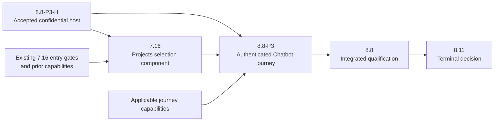

# Break the Chatbot host and selection evidence dependency cycle

## 1. Issue summary

Implementation readiness failed before sprint planning regenerated the tracker. On the trigger baseline, Story 7.16 required the accepted 8.8-P3 pin to start, while 8.8-P3 required authenticated FR-25 evidence from the Projects-owned component delivered by 7.16. The production-authority guard passed for Epics 6–8 and the traceability matrix covered all 25 FRs and 11 NFRs. The dependency cycle blocked both sides. [Trigger report](implementation-readiness.md)

## 2. Impact analysis

| Area | Impact |
|---|---|
| Epic 6 | Eight stories are done. The epic remains in progress while the Projects maintainer and Test Architect qualify v4 on the intended pinned revision with 77 comparison cells and seven authenticated retained HTTP reads under explicit rollback. The historical v3 receipts apply to their recorded inputs. [Tracker](../implementation-artifacts/sprint-status.yaml) · [Cutover runbook](../../docs/read-cutover.md#selection-and-rollback) |
| Epic 7 | Give 7.16 an independently accepted host prerequisite. Keep the first-writer entry requirements for 7.1, including 7.1-P1/P2, DW-63, AD-17 and AD-35. Stories 7.1, 7.3, 7.7, 7.9 and 7.14 consume the selection contract. Run positive Chatbot selection through their affected paths after the component is available. Retain each earlier path’s own admission and acceptance contract. [Epic 7](epics.md#epic-7-users-complete-durable-project-decisions-and-recover-them) |
| Epic 8 | Full 8.8-P3 remains required by 8.8, and 8.11 remains the terminal release decision. The internal 8.1 preview remains blocked at acceptance. Dated Product Owner and authorized Solution Architect decisions are still required to retain both tracks on the reviewed baseline. [Epic 8](epics.md#epic-8-operators-run-projects-safely-and-release-owners-decide-from-evidence) · [Conformance packet](epics-architecture-conformance-checklist-2026-07-16.md#section-g--human-signoff-packet) |
| PRD and architecture | Preserve the v1 scope and the FR-25, NFR-8, NFR-9 and NFR-11 requirements. The proposal applies AD-2, AD-5, AD-13, AD-20, AD-29, AD-30, AD-33 and AD-34 at two evidence checkpoints. Record their ordering in the epic and conformance packet. [PRD FR-25](prds/prd-Hexalith.Projects-2026-05-24/prd.md#fr-25-select-association-target) · [Architecture Spine](architecture/architecture-projects-2026-07-15/ARCHITECTURE-SPINE.md) |
| UX and verification | Update the host and journey evidence instructions under **Chatbot Companion Release Input**. The Chatbot owner qualifies the host using an authenticated probe and later exercises the shipped component in the actual journey. Existing journey states, accessibility requirements, canonical evidence keys and release profiles remain binding. [UX specification](ux-design-specification.md#chatbot-companion-release-input) · [Canonical matrix](implementation-readiness-traceability-matrix.yaml) |

## 3. Recommended approach

**Moderate direct adjustment.** Add `8.8-P3-H` as a separately accepted host prerequisite recorded under the existing `8.8-P3` action. The same Chatbot owners can produce host proof as soon as the registration and session contract is usable. Story 7.16 then consumes its immutable host reference. Full 8.8-P3 consumes the real component and the applicable completed journey inputs. This keeps evidence acquisition with its owners and preserves the existing release chain.

The planning change is small. Host qualification is medium effort and risk, subject to owner access to authenticated registration and fixtures. The main risks are mistaking host qualification for journey proof and reusing a pin after drift. Independent approvals, distinct pin paths, and exact candidate bindings address both. The host lane can run in parallel with writer prerequisites. Owner availability and the authenticated fixture determine timing.

Rolling back completed reads would leave the dependency cycle in place and require requalifying retained work. Reducing MVP scope would remove required FR-25 or NFR-9 coverage. The existing requirement set is achievable with the dependency change. Epic 8 restructuring remains a separate governance decision.

## 4. Proposed edits

### 4.1 Story 7.16 and first-writer sequencing

**Before.** Story 7.16’s entry gate requires “the accepted 8.8-P3 companion pin for the Chatbot host.”

**After.** “Entry gate. Epic 7 gate, G-2, G-3, G-5 and the accepted `8.8-P3-H` confidential Chatbot host pin. Consume Story 6.1 permitted enumeration and the independently accepted, immutable record for Story 7.1’s Folder-first writer capability. Projects delivers the registered confidential Project User selection component and records `fr-25` evidence at completion. Full 8.8-P3 runs downstream.” Keep the existing acceptance criteria and v1 surface boundary. [Story 7.16](epics.md#story-716-select-an-association-target)

Add a sequencing note to the 7.1 and 7.16 dependency text. Qualify the first writer on the independently provable create-only no-Folder flow and the persisted claim-and-commit boundary with pinned Folders authorization. Keep `RequestPreview` on supplied-Folder requests without valid Selection Evidence. The writer capability record closes the 7.16 dependency when accepted, independently of 7.1’s whole-story status. Test the real actor-selected supplied-Folder journey with the delivered 7.16 component before recording complete integrated FR-1/FR-25 coverage. Apply the same ordering to positive composition for 7.3, 7.7, 7.9 and 7.14. The first-writer proof still requires two competing Projects, recovery after a lost reply on another replica, one recoverable fenced claim, authoritative histories proving at most one Active holder, stale commit and release refusal, and correct legacy-incumbent handling. [Story 7.1](epics.md#story-71-activate-a-project-with-exactly-one-authorized-folder) · [AD-35](architecture/architecture-projects-2026-07-15/ARCHITECTURE-SPINE.md#ad-35--adopted-projects-owns-the-exclusive-active-project-folder-claim)

### 4.2 8.8-P3 host prerequisite and full journey

**Before.** 8.8-P3 has one acceptance record and one Projects pin. That acceptance requires the complete authenticated Chatbot journey, including FR-25 and NFR-9.

**After.** Add the following two acceptance checkpoints to **Story 8.8 prerequisite evidence packages**. [8.8-P3 contract](epics.md#story-88-prerequisite-evidence-packages)

| Checkpoint | Acceptance |
|---|---|
| `8.8-P3-H` confidential host | The Chatbot Presentation Owner and Chatbot Test Owner approve a versioned owner-repository manifest at an immutable revision. It specifies the Projects component mount and its platform registration, supported FrontComposer and identity bindings, pinned host and mount/session contract revisions, environment, authenticated commands, deterministic fixture, result and artifact paths and hashes, and drift containment with an exercised rollback. Exercise the actual confidential host identity and session path with an inert component probe. Demonstrate successful mounting only for the registered confidential Project User context with server-derived Tenant, original actor, authenticated workload and the actor’s interactive session and surface. Verify the Projects fixture authority issues a session-bound test credential that stays inside the probe. Refuse missing or mismatched registration, noninteractive or Tenant-role identities, wrong workload or audience, and changed, revoked or cross-Tenant, cross-actor, cross-session or cross-surface bindings. The probe may exercise only the host boundary. Its runs create zero Selection Evidence, Confirmation Artifacts, tasks or Project effects. Host acceptance depends on the pinned host-specific registration and identity inputs, independently of Story 7.16, the full Epic 8 gate and the completed journey. |
| `8.8-P3` full companion journey | Keep the complete existing manifest and authenticated behavior, privacy, recovery and NFR-9 accessibility criteria. The owner manifest identifies the accepted host pin and digest, the immutable Projects revision containing the 7.16 component, the tested compatible Chatbot revision, and the applicable journey capabilities. Exercise the shipped component and its actual owner and platform paths. Verify the host pin belongs to the tested contract and coordinates. Retest and obtain owner acceptance of any changed material binding before reuse. |

The Chatbot owners publish and approve both manifests from their owning repository. FrontComposer and Platform/Identity owners attest the host integrations they supply. The Projects Owner verifies compatibility, and the Product Owner and Test Architect record separate Projects references after the applicable external approvals. The proposed host-only reference is `evidence/epic8/8.8-P3-H-chatbot-host-pin.json`. Retain `evidence/epic8/8.8-P3-chatbot-companion-pin.json` for the full journey. Record each referenced owner manifest’s immutable repository revision and digest, contract/version and dependency coordinates, approval identities, authority and dates, evidence disposition, and rollback reference. Full P3 remains `blocked-external` until its own manifest and Projects reference pass. Story 8.8 continues to consume all three complete packages, 8.8-P1/P2/P3.

**Failure behavior.** Missing, mutable, unapproved, mismatched or drifted host evidence keeps selection disabled for the affected host. Rollback disables selection or restores an independently reverified compatible binding. An attempted association without valid Selection Evidence receives `RequestPreview`. Progress through a confirmation path requires its own registered authority. Public CLI/MCP refusal, current Folder manage checks, component-only minting, five-minute expiry, and atomic single-use consumption remain enforceable on the actual component.

### 4.3 UX, architecture and traceability

| Artifact | Before | Proposed wording or edit |
|---|---|---|
| UX, **Chatbot Companion Release Input** | One companion pin is specified with the full journey. | “Projects binds the confidential host from independently accepted 8.8-P3-H evidence. The host-only probe exercises registration and session isolation with selection disabled. The shipped 7.16 component is required for authenticated FR-25 journey qualification. Full 8.8-P3 remains the companion release input for 8.8 and 8.11.” Keep the existing accessibility and journey list. |
| Architecture conformance packet, **Section G** | The prior packet recorded a prior-only pass and used August and September hashes. | “The current 7.16/P3 cycle blocks the dependency check. Reverify the corrected order against the applied baseline. Evaluate the Epic 8 cohesion decision using AD-30 and require both dated owner decisions.” Keep the existing Spine decisions and diagrams as the architecture authority. |
| Canonical evidence matrix and Markdown view | `fr-25` names the full P3 pin in its blocker. The accessibility rows explicitly require P3. | Add `8.8-P3-H` to `fr-25` entry gates, update its blocker and record the host reference as prerequisite provenance. Keep the 7.16 executable test and actual component artifact as `fr-25` proof. Clarify in `nfr-9` and `release-accessibility` that full P3 evidence consumes 7.16 and remains required alongside P2. Preserve all 64 stable keys, owners, row statuses and release dispositions at planning application. |
| Sprint tracker, `action_items` entry `8.8-P3` | One exact guarded action ID with external evidence pending. | Keep the top-level ID and `blocked-external` state. Record `8.8-P3-H` as a separately tracked prerequisite with its own owner, expected pin, acceptance state and route to 7.16. Update the full package dependency list to include the accepted host and completed component plus the applicable prior journey capabilities. At planning application the host is `blocked-external` and all development statuses retain their recorded values. |

The PRD’s product requirements and the Architecture Spine’s rules already govern this boundary. The change is to package sequencing and evidence prerequisites. The CI and deployment owners continue to run their existing release gates. Add the Chatbot owner’s host and journey fixture checks to the owner evidence plan.

## 5. Implementation handoff

1. **Product Owner and Projects developer.** After proposal approval, reconcile the epic, UX, both matrix views and existing package action together. Keep the current story inventory and the guarded status values. Validate any tracker candidate using the production-authority guard and complete isolated candidate bundle required by the project context. Validate the nested host fields and revised dependency edges explicitly. The existing guard validates inventory and statuses, and pins 7.16 to backlog and P3 to `blocked-external`. Before any later status progression, extend the guard and tests narrowly to enforce that only a valid host pin can satisfy the host prerequisite, full P3 requires the real 7.16 output and its own pin, and an invalid, absent, drifted or wrong-stage reference cannot advance either stage. All existing readiness and story entry gates still apply. [Project context](../project-context.md) · [Scheduling guard](../../tools/planning/validate_production_authority.py)
2. **Chatbot Presentation and Test Owners, with Projects, FrontComposer and Platform Identity owners.** Supply and validate host-only acceptance. Implement 7.16 after all its entry gates are accepted. Run the full authenticated Chatbot journey with the real component and eligible consumers, then record complete 8.8-P3 acceptance.
3. **Projects, EventStore, Platform and Folders owners, with Solution and Test Architects.** Deliver the first-writer inputs in the current contracts. Projects and EventStore own DW-63. EventStore, Platform and Folders own the pinned 7.1-P2 task and provisioning contract inputs. Projects owns the AD-35 cross-replica claim evidence, and Folders supplies current resource and actor-authorization evidence. Projects must complete 7.15 before Story 8.1 can pass acceptance. The Test Architect validates `fr-21`, `nfr-8`, `finding-test-001` and `release-authenticated-persisted-boundary` using governed Epic 8 fixtures and blocking CI. [Story 8.1 verification](../implementation-artifacts/spec-8-1-inspect-task-audit-and-reconciliation-truth.md#verification)
4. **Product Owner and authorized Solution Architect.** Reverify and record the decision on both Epic 8 tracks against the exact applied baseline. If either rejects retention, commission the separate structural course correction required by Epic 8. Keep governance, readiness and the eventual dated 8.11 decision explicit. [Conformance packet](epics-architecture-conformance-checklist-2026-07-16.md#section-g--human-signoff-packet)
5. **Test Architect and sprint planning.** Verify the revised dependency graph, stable evidence identities and guard against the applied candidate. Rerun implementation readiness independently. Regenerate the sprint tracker only after the readiness gate permits it. Existing Epic 6 v4 qualification and Epic 8 release actions continue with their owners.

## 6. Approval and application record

The requester explicitly approved this planning correction on November 24. Projects applied the
Story 7.1 and 7.16 sequencing, the two Chatbot acceptance contracts, and their UX and traceability
references. The tracker records the nested host prerequisite under the existing 8.8-P3 action.
The production-authority guard accepted the isolated candidate and the published tracker.
All existing development and evidence statuses retain their recorded values.

The Product Owner and Projects developer own the planning handoff. The Chatbot Presentation and
Test Owners own host and journey acceptance. The applied-baseline Epic 8 decision packet is ready
for the Product Owner and authorized Solution Architect, whose decisions are pending. The readiness
rerun records the outstanding execution inputs. [Conformance packet](epics-architecture-conformance-checklist-2026-07-16.md#section-g--human-signoff-packet) · [Readiness rerun](implementation-readiness-report-2026-11-24-rerun.md)
